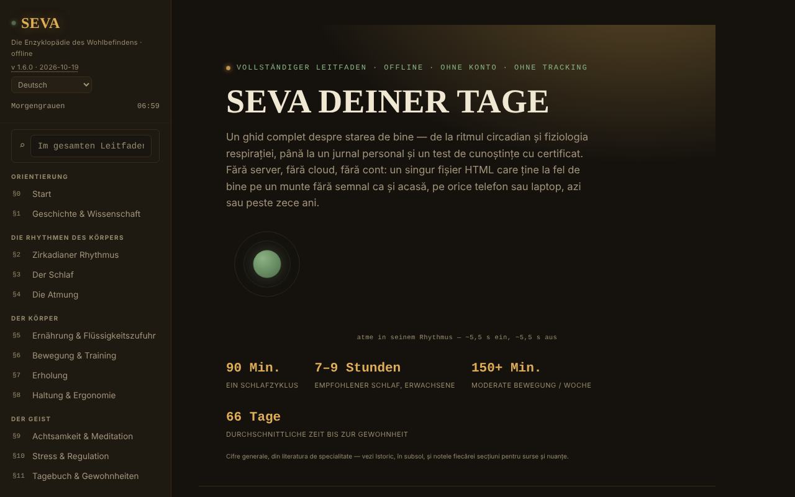

# SEVA — Die Enzyklopädie des Wohlbefindens

[English](README.md) · [Română](README.ro.md) · [Français](README.fr.md) · [Italiano](README.it.md) · [Español](README.es.md) · [Português](README.pt.md) · **Deutsch** · [Magyar](README.hu.md)

**Version:** 1.6.5 · **Zuletzt aktualisiert:** 2026-10-22

Oberflächensprachen: **Română, English, Français, Italiano, Español, Português (PT), Deutsch, Magyar**

Ein umfassender Leitfaden zum Wohlbefinden, in einer einzigen HTML-Datei, ohne Konto und ohne Tracking.

**Online-App:** https://chiuta.github.io/SEVA/

## Was es ist

SEVA ist eine interaktive Enzyklopädie (in 8 Sprachen) über Schlaf, zirkadianen Rhythmus, Atmung, Ernährung, Bewegung, Regeneration, Haltung, Achtsamkeit, Stress, Tagebuch und Gewohnheiten, mit praktischen Werkzeugen. Die App stellt klar, dass sie ärztliche oder psychologische Versorgung nicht ersetzt und Nachschlagematerial sowie Werkzeuge zur Selbstbeobachtung bietet, keine Diagnose und keine Behandlung.

**Sprachen:** alle langen Texte (Abschnitte, Intro, Hinweise, Verlauf: rund 43.000 Zeichen), das Glossar und die Quizdatenbank (226 Zeichenfolgen) liegen in den 8 Sprachen vor; Eigennamen, Sprachnamen und Zitate/Normbezeichnungen bleiben unverändert. Die Übersetzungen sind automatisch und nicht von Muttersprachlern geprüft; **alle Gesundheitsinhalte (Atmung, Schlaf, Ernährung, Bewegung, Stress, Krisenressourcen, Quiz, Glossar) müssen fachlich geprüft werden**; die App ersetzt keine medizinische oder psychologische Versorgung.

## Funktionen

Der Inhalt ist in nummerierte Abschnitte gegliedert (Seitenmenü, ☰ auf dem Smartphone):

- Orientierung: Startseite, Geschichte & Wissenschaft.
- Die Rhythmen des Körpers: Zirkadianer Rhythmus (interaktives Zifferblatt als SVG gezeichnet), Der Schlaf, Die Atmung.
- Der Körper: Ernährung & Flüssigkeitszufuhr, Bewegung & Training, Regeneration, Haltung & Ergonomie.
- Der Geist: Achtsamkeit & Meditation, Stress & Regulation, Tagebuch & Gewohnheiten.
- Alltagspraxis: Ein ausgewogener Tag, Das Wellness-Set, Rechner & Werkzeuge, Herausforderungen & Ziele.
- Ressourcen: Wenn du Hilfe brauchst, Wissenstest (mit Abschlusszertifikat), Glossar A–Z.
- Perspektive: Dashboard & Muster.
- Lesekomfort in der Seitenleiste: Textgröße (A−/A+, 100–150 %), „Lesbarer Text“ (serifenlose Schrift mit vergrößertem Abstand) und hoher „Kontrast“; hoher Kontrast wird automatisch aktiviert, wenn das System ihn verlangt (`prefers-contrast: more`). Die Einstellungen gelten nur für die Sitzung (im Browser wird nichts gespeichert).
- Das Anfangsdesign folgt der Systemeinstellung (`prefers-color-scheme`); das Kürzel `/` setzt den Fokus auf die globale Suche.
- Globale Suche, Tag/Nacht-Design, Anzeige der „Tagesphase“, Drucken des aktuellen Abschnitts, „Dateiintegrität prüfen“ (SHA-256 des DOM beim Laden), „Woraus die Datei besteht“ und „Fehler melden“ (GitHub-Link).
- „🔊 Aktuellen Abschnitt anhören“ (Seitenleiste): liest den geöffneten Abschnitt über die Sprachsynthese des Browsers (`speechSynthesis`, Sprache `ro-RO`; die Qualität hängt von den im System installierten Stimmen ab; die Schaltfläche wird ausgeblendet, wenn der Browser sie nicht bietet) laut vor; sie stoppt beim zweiten Drücken oder beim Wechsel des Abschnitts. Keine Netzwerkanfragen der App.
- Das Tagebuch, persönliche Notizen, der Fortschritt der verteilten Wiederholung und das Zertifikat können als JSON-Dateien exportiert/importiert werden.

## Neue Funktionen (v1.4.0, 14. Oktober 2026)

Keine neuen Lernfunktionen in dieser Version: **Die verteilte Wiederholung gibt es bereits** (§17 Wissenstest, „Modus: Verteilte Wiederholung“, vereinfachtes SM-2, mit Export/Import des Fortschritts) und wurde nicht dupliziert. Die einzige Ergänzung ist das unten beschriebene Kit.

### Transparenz und Datensicherung (fff-kit)

Ein Klick (oder die Eingabetaste) auf die angezeigte Version (`v 1.4.0 · 2026-10-14`) öffnet das Fenster „Transparenz“: die deklarierten Netzwerk-Hosts (0 externe Anfragen), die lokalen Speicherschlüssel mit Größen, die verwendeten APIs, Größe und SHA-256 der Datei (mit einem Prüfwerkzeug für eine heruntergeladene Datei) sowie die **Sicherung** der App-Daten in einer `.fff.json`-Datei (optional mit Passwort verschlüsselt, AES-GCM 256 / PBKDF2; das Passwort lässt sich nicht wiederherstellen), den Import mit Bestätigung und das Löschen der App-Daten. Das Kit (`fff-kit`, Module: core, label, bundle) ist in `index.html` eingefügt, stellt keine Netzwerkanfragen und ändert keine vorhandenen Daten; ohne es funktioniert die App genauso. SEVA verwendet kein `localStorage`, daher wird die Sicherung des Kits (fast) leer sein; der Testfortschritt bleibt über „Exportă progresul“ (Fortschritt exportieren) exportierbar. Die Texte des Kits liegen in 8 Sprachen vor (ro, en, fr, it, es, pt, hu, de); **die Übersetzungen fr/it/es/pt/hu/de sind automatisch erstellt und nicht von Muttersprachlern geprüft**. Oberfläche und Inhalt der App liegen ebenfalls in den 8 Sprachen vor (siehe den Sprachhinweis am Anfang); die Inhaltsübersetzungen sind automatisch und nicht von Muttersprachlern geprüft.

## Anleitung

1. Navigiere über das Seitenmenü (☰ auf dem Smartphone) oder die globale Suche (⌕).
2. Wechsle das Design mit „☾ Noapte“ (Nacht) / „☀ Zi“ (Tag).
3. Nutze die interaktiven Abschnitte (das zirkadiane Zifferblatt, die Atemübungen, die Rechner, den BOLT-Test usw.) direkt auf der Seite.
4. In §11 Tagebuch & Gewohnheiten: Das Tagebuch lebt nur im Speicher, solange die Seite geöffnet ist, und verschwindet beim Neuladen. Drücke „💾 Exportă jurnalul (.json)“ (Tagebuch exportieren (.json)), um es als `seva-jurnal.json` zu speichern, und „📂 Importă“ (Importieren), um es bei einem späteren Besuch wieder zu laden (es gibt auch „Distribuie fișierul“ (Datei teilen)).
5. Die Notizen (`seva-notite.json`) und der Fortschritt der verteilten Wiederholung (`seva-repetitie-spatiata.json`) werden ebenfalls über „💾 Exportă (.json)“ und „💾 Exportă progresul“ gespeichert und über „📂 Importă“ / „📂 Importă progresul“ wieder geladen.
6. Trage in §17 Wissenstest den Namen für das Zertifikat ein und drücke „Generează certificat“ (Zertifikat erzeugen); das Zertifikat wird als `seva-certificat.json` heruntergeladen.
7. „Printează secțiunea curentă“ (Aktuellen Abschnitt drucken) druckt den geöffneten Abschnitt.

## Datenschutz und Netzwerk

- Die App gibt ausdrücklich an, dass sie weder localStorage noch sessionStorage noch Cookies verwendet; im Code gibt es keine Aufrufe dazu. Der Zustand existiert nur im Speicher bis zum Neuladen, abgesehen von den Dateien, die du selbst exportierst.
- Sie stellt keine Netzwerkanfragen (kein `fetch`, kein CDN, keine externen Skripte). Sie enthält nur Links, die beim Anklicken geöffnet werden: mentalhealthforromania.org, findahelpline.com, antisuicid.ro, who.int, sleepfoundation.org, github.com (Fehlermeldung), trom.tf und chiuta.github.io.

## Lokal / offline ausführen

Lade `index.html` herunter und öffne sie in einem Browser; sie benötigt kein Internet (externe Links werden nur beim Anklicken geöffnet).

## Verlauf / Changelog

### 1.6.5 — 2026-10-22
- fff-kit 1.1.2: PBKDF2 mit 600.000 Iterationen, Schutz vor Clickjacking

### 1.6.4 — 2026-10-22
- Barrierefreiheit: genau eine H1 auf der Seite (der Startseitentitel ist ein H2-Element, das als Ebene 1 angekündigt wird; das Aussehen bleibt gleich).
- Mobil: Aller Text hat mindestens 12 px; Links in der Fußzeile und zu den Quellen haben eine größere Tippfläche.

### 1.6.3 — 2026-10-22
- Übersetzungskorrektur: Beschreibung (und Name) im Transparenzfenster folgen jetzt der Oberflächensprache.

### 1.6.2 — 2026-10-22
- Übersetzungskorrekturen: Seitentitel und Meta-Tags folgen der Oberflächensprache; Platzhalter und Beschriftungen der Textfelder übersetzt; ein einzelnes rumänisches Wort entfernt.

### 2026-10-19 (v1.6.1)
- Alle langen Texte, das Glossar und die Quizdatenbank sind nach en, fr, it, es, pt, de, hu übersetzt (683 neue Wörterbuchzeilen); der Satz „die langen Texte bleiben auf Rumänisch“ wurde entfernt. Die Gesundheitsinhalte müssen fachlich geprüft werden.

### 19. Oktober 2026 (v1.5.0)
- Die Adresse `#sec=<id>[&from=<slug>]` öffnet direkt einen vorhandenen Abschnitt (eine unbekannte ID wird ignoriert). Der Inhalt hat sich nicht geändert.

### 14. Oktober 2026 (v1.4.0)
- fff-kit: Fenster „Transparenz“ und einheitliche Datensicherung. Der Inhalt und die verteilte Wiederholung haben sich nicht geändert.

### 12. Oktober 2026 (v1.3.4)
- 1.3.4 — 2026-10-12: Die Version und das Datum der letzten Aktualisierung werden in der App angezeigt

### 11. Oktober 2026 (v1.3.3)
- Neue Funktion: „Aktuellen Abschnitt anhören“ (Vorlesen, getestet mit simulierter Sprachsynthese: Start, Stopp, Abschnittswechsel, Ende).
- Größere Touch-Ziele für die Links und Schaltflächen in der Fußzeile der Seitenleiste.

### 11. Oktober 2026 (v1.3.2)
- Lesekomfort (Textgröße, lesbarer Text, hoher Kontrast), Anfangsdesign nach Systemeinstellung, Kürzel `/`, Unterstützung für `forced-colors`.
- Darstellung der Werkzeugleiste in der Fußzeile korrigiert (die Links zum Melden/Drucken/zur Integrität waren in einer einzigen Zeile gequetscht); die zirkadianen Zifferblätter werden auf schmalen Bildschirmen kleiner.
- CSP: `script-src` mit Hash statt `'unsafe-inline'`.
- Screenshot aktualisiert.

### 11. Oktober 2026 (v1.3.1)
- Die globale Suche und das Glossar ignorieren jetzt diakritische Zeichen („meditatie“ findet „meditație“).
- Barrierefreiheit: mobile Kopfleiste als <header>, Reihenfolge der Überschriften korrigiert (axe: 0 Verstöße).
- Strikte CSP hinzugefügt (keine Netzwerkverbindungen); Version 1.3.1 in der App.

## Lizenz

MIT — siehe die Datei `LICENSE`. © 2026 Alexandru-Ionuț Chiuță (Alexio). Eventuell in die Datei eingebundene Drittanbieter-Bibliotheken behalten ihre eigenen Lizenzen.

## Autor

Alexio — Alexandru-Ionuț Chiuță, Kontakt: alexio@trom.tf

## Zusammenfassung

SEVA ist eine 8-sprachige Enzyklopädie des Wohlbefindens in einer einzigen Datei: zirkadianer Rhythmus, Schlaf, Atmung, Ernährung, Bewegung, Erholung, Haltung, Achtsamkeit, Stress, Gewohnheiten, mit Rechnern, Tagebuch, einem Wissensquiz mit Abschlusszertifikat und einem Glossar. Sie ist keine medizinische Beratung. Es gibt Optionen für Lesekomfort (Textgröße, gut lesbare Schrift, hoher Kontrast; nur für die Sitzung). Sie speichert nichts im Browser (Tagebuch, Notizen und Fortschritt werden als JSON exportiert/importiert) und stellt keine Netzwerkanfragen.

## Audit

Audit: 2026-10-10 — geprüft: 0 JS-Fehler, 0 Netzwerkanfragen, 0 Verwendungen von localStorage/sessionStorage/Cookies; axe (WCAG 2.1 AA) auf allen Abschnitten, im Nacht- und im Tagdesign sowie auf dem Smartphone ausgeführt, ohne Verstöße der Stufe serious/critical nach den Kontrastkorrekturen. Der Gesundheitsinhalt ist informativ und wurde nicht medizinisch validiert; die Nummer des TelVerde Antisuicid (0800 801 200) und seine Zeiten können vom Betreiber geändert werden.
