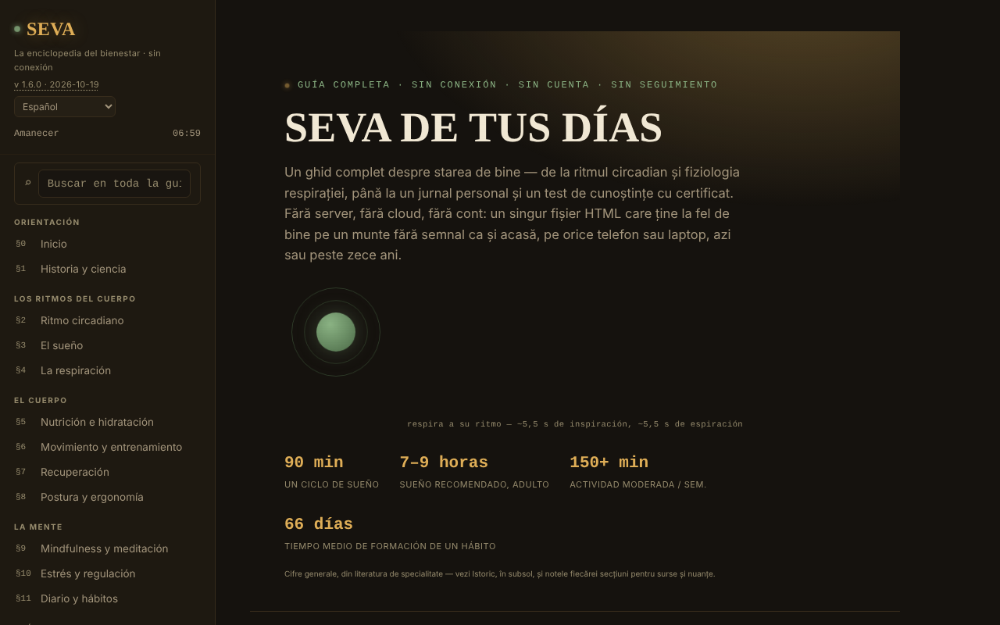

# SEVA — La enciclopedia del bienestar

[English](README.md) · [Română](README.ro.md) · [Français](README.fr.md) · [Italiano](README.it.md) · **Español** · [Português](README.pt.md) · [Deutsch](README.de.md) · [Magyar](README.hu.md)

**Versión:** 2.0.0 · **Última actualización:** 2026-10-26

Idiomas de la interfaz: **Română, English, Français, Italiano, Español, Português (PT), Deutsch, Magyar**

Una guía completa del bienestar, en un único archivo HTML, sin cuenta y sin seguimiento.

**Aplicación en línea:** https://chiuta.github.io/SEVA/

## Qué es

SEVA es una enciclopedia interactiva (en 8 idiomas) sobre el sueño, el ritmo circadiano, la respiración, la nutrición, el movimiento, la recuperación, la postura, el mindfulness, el estrés, el diario y los hábitos, con herramientas prácticas. La aplicación precisa que no sustituye la atención médica ni psicológica y que ofrece referencia y herramientas de autoobservación, no diagnóstico ni tratamiento.

**Idiomas:** todos los textos largos (secciones, intro, notas, historial: unos 43 000 caracteres), el glosario y el banco del cuestionario (226 cadenas) están disponibles en los 8 idiomas; los nombres propios, los nombres de idiomas y las citas/nombres de normas permanecen sin cambios. Las traducciones son automáticas, no verificadas por hablantes nativos; **todo el contenido de salud (respiración, sueño, nutrición, movimiento, estrés, recursos de crisis, cuestionario, glosario) requiere revisión especializada**; la aplicación no sustituye la atención médica ni psicológica.

## Funciones

El contenido está organizado en secciones numeradas (menú lateral, ☰ en móvil):

- Orientación: Inicio, Historia & ciencia.
- Los ritmos del cuerpo: Ritmo circadiano (esfera interactiva dibujada en SVG), El sueño, La respiración.
- El cuerpo: Nutrición & hidratación, Movimiento & entrenamiento, Recuperación, Postura & ergonomía.
- La mente: Mindfulness & meditación, Estrés & regulación, Diario & hábitos.
- Práctica cotidiana: Un día equilibrado, El botiquín del bienestar, Calculadoras & herramientas, Retos & objetivos.
- Recursos: Cuando necesitas ayuda, Prueba de conocimientos (con certificado de finalización), Glosario A-Z.
- Perspectiva: Panel de control & patrones.
- Comodidad de lectura en la barra lateral: tamaño del texto (A−/A+, 100–150 %), «Texto legible» (fuente sans-serif con mayor espaciado) y «Contraste» alto; el contraste alto se activa automáticamente si el sistema lo solicita (`prefers-contrast: more`). Los ajustes existen solo durante la sesión (no se guarda nada en el navegador).
- El tema inicial sigue la preferencia del sistema (`prefers-color-scheme`); el atajo `/` mueve el foco a la búsqueda global.
- Búsqueda global, tema Día/Noche, indicador de «fase del día», impresión de la sección actual, «Verificar la integridad del archivo» (SHA-256 del DOM al cargar), «De qué está hecho el archivo» e «Informar de un error» (enlace a GitHub).
- «🔊 Escuchar la sección actual» (barra lateral): lee en voz alta la sección abierta mediante la síntesis de voz del navegador (`speechSynthesis`, idioma `ro-RO`; la calidad depende de las voces instaladas en el sistema; el botón se oculta si el navegador no la ofrece); se detiene al pulsar por segunda vez o al cambiar de sección. Sin solicitudes de red por parte de la aplicación.
- El diario, las notas personales, el progreso de repetición espaciada y el certificado se pueden exportar/importar como archivos JSON.

## Novedades (v1.4.0, 14 de octubre de 2026)

Sin nuevas funciones de aprendizaje en esta versión: **la repetición espaciada ya existe** (§17 Prueba de conocimientos, «Modo: Repetición espaciada», SM-2 simplificado, con exportación/importación del progreso) y no se ha duplicado. La única adición es el kit que se describe a continuación.

### Transparencia y copia de seguridad (fff-kit)

Un clic (o Intro) sobre la versión mostrada (`v 1.4.0 · 2026-10-14`) abre la ventana «Transparencia»: los hosts de red declarados (0 solicitudes externas), las claves de almacenamiento local con sus tamaños, las API utilizadas, el tamaño y el SHA-256 del archivo (con un verificador para un archivo descargado) y la **copia de seguridad** de los datos de la aplicación en un archivo `.fff.json` (opcionalmente cifrado con contraseña, AES-GCM 256 / PBKDF2; la contraseña no se puede recuperar), la importación con confirmación y el borrado de los datos de la aplicación. El kit (`fff-kit`, módulos: core, label, bundle) está integrado en `index.html`, no realiza solicitudes de red y no modifica los datos existentes; sin él, la aplicación funciona igual. SEVA no usa `localStorage`, por lo que la copia de seguridad del kit estará (casi) vacía; el progreso de la prueba sigue siendo exportable mediante «Exportă progresul» (Exportar el progreso). Los textos del kit están en 8 idiomas (ro, en, fr, it, es, pt, hu, de); **las traducciones fr/it/es/pt/hu/de son automáticas y no están verificadas por hablantes nativos**. La interfaz y el contenido de la aplicación también están disponibles en los 8 idiomas (véase la nota sobre idiomas al principio); las traducciones del contenido son automáticas, no verificadas por hablantes nativos.

## Guía de uso

1. Navega desde el menú lateral (☰ en el teléfono) o desde la búsqueda global (⌕).
2. Cambia el tema con «☾ Noapte» (Noche) / «☀ Zi» (Día).
3. Usa las secciones interactivas (la esfera circadiana, los ejercicios de respiración, las calculadoras, la prueba BOLT, etc.) directamente en la página.
4. En el §11 Diario & hábitos: el diario vive solo en memoria mientras la página está abierta y desaparece al recargar. Pulsa «💾 Exportă jurnalul (.json)» (Exportar el diario (.json)) para guardarlo como `seva-jurnal.json` y «📂 Importă» (Importar) para recargarlo en una visita futura (también existe «Distribuie fișierul» (Compartir el archivo)).
5. Las notas (`seva-notite.json`) y el progreso de repetición espaciada (`seva-repetitie-spatiata.json`) se guardan también mediante «💾 Exportă (.json)» y «💾 Exportă progresul», y se recargan mediante «📂 Importă» / «📂 Importă progresul».
6. En el §17 Prueba de conocimientos, escribe el nombre para el certificado y pulsa «Generează certificat» (Generar certificado); el certificado se descarga como `seva-certificat.json`.
7. «Printează secțiunea curentă» (Imprimir la sección actual) imprime la sección abierta.

## Privacidad y red

- La aplicación indica explícitamente que no usa localStorage, sessionStorage ni cookies; en el código no hay llamadas a ellos. El estado existe solo en memoria hasta la recarga, aparte de los archivos que exportes tú.
- No realiza solicitudes de red (sin `fetch`, CDN ni scripts externos). Contiene solo enlaces, que se abren al hacer clic: mentalhealthforromania.org, findahelpline.com, antisuicid.ro, who.int, sleepfoundation.org, github.com (notificación de errores), trom.tf y chiuta.github.io.

## Ejecución local / sin conexión

Descarga `index.html` y ábrelo en un navegador; no requiere internet (los enlaces externos se abren solo al hacer clic).

## Historial / Changelog

### 1.6.9 — 2026-10-23

- Objetivos táctiles de al menos 44 px en dispositivos táctiles (`pointer:coarse`); el escritorio no cambia.

### 1.6.7 — 2026-10-22

fff-kit 1.1.4: objetivos táctiles y tamaño mínimo de texto; objetivos táctiles y texto corregidos.

### 1.6.6 — 2026-10-22
- Accesibilidad: el campo de búsqueda muestra ahora un anillo de foco claro (contraste de al menos 3:1) en los temas noche y día.

### 1.6.5 — 2026-10-22
- fff-kit 1.1.2: PBKDF2 con 600.000 iteraciones, protección anti-clickjacking

### 1.6.4 — 2026-10-22
- Accesibilidad: un solo H1 en la página (el título de inicio es un elemento de nivel 2 anunciado como nivel 1; el aspecto no cambia).
- Móvil: todo el texto pasa a un mínimo de 12 px; los enlaces del pie y de las fuentes tienen un área táctil mayor.

### 1.6.3 — 2026-10-22
- Corrección de traducción: la descripción (y el nombre) del panel de transparencia siguen ahora el idioma de la interfaz.

### 1.6.2 — 2026-10-22
- Correcciones de traducción: el título de la página y las metaetiquetas siguen el idioma de la interfaz; marcadores y etiquetas de las áreas de texto traducidos; eliminada una palabra rumana aislada.

### 2026-10-19 (v1.6.1)
- Todos los textos largos, el glosario y el banco del cuestionario están traducidos a en, fr, it, es, pt, de, hu (683 filas nuevas de diccionario); se eliminó la frase «los textos largos siguen en rumano». El contenido de salud requiere revisión especializada.

### 19 de octubre de 2026 (v1.5.0)
- La dirección `#sec=<id>[&from=<slug>]` abre directamente una sección existente (un id desconocido se ignora). El contenido no ha cambiado.

### 14 de octubre de 2026 (v1.4.0)
- fff-kit: ventana «Transparencia» y copia de seguridad unificada. El contenido y la repetición espaciada no han cambiado.

### 12 de octubre de 2026 (v1.3.4)
- 1.3.4 — 2026-10-12: la versión y la fecha de la última actualización se muestran en la aplicación

### 11 de octubre de 2026 (v1.3.3)
- Función nueva: «Escuchar la sección actual» (lectura en voz alta, probada con síntesis simulada: inicio, parada, cambio de sección, finalización).
- Zonas táctiles más grandes para los enlaces y botones del pie de la barra lateral.

### 11 de octubre de 2026 (v1.3.2)
- Comodidad de lectura (tamaño del texto, texto legible, contraste alto), tema inicial según la preferencia del sistema, atajo `/`, compatibilidad con `forced-colors`.
- Corregido el aspecto de la barra de herramientas del pie (los enlaces de informe/impresión/integridad estaban apretados en una sola fila); las esferas circadianas se reducen en pantallas estrechas.
- CSP: `script-src` con hash en lugar de `'unsafe-inline'`.
- Captura de pantalla actualizada.

### 11 de octubre de 2026 (v1.3.1)
- La búsqueda global y el glosario ahora ignoran los signos diacríticos («meditatie» encuentra «meditație»).
- Accesibilidad: barra superior móvil como <header>, orden de los encabezados corregido (axe: 0 violaciones).
- Añadida una CSP estricta (sin conexiones de red); versión 1.3.1 en la aplicación.

## Licencia

MIT — véase el archivo `LICENSE`. © 2026 Alexandru-Ionuț Chiuță (Alexio). Las posibles bibliotecas de terceros incluidas en el archivo conservan sus propias licencias.

## Autor

Alexio — Alexandru-Ionuț Chiuță, contacto: alexio@trom.tf

## Resumen

SEVA es una enciclopedia del bienestar de un único archivo, en 8 idiomas: ritmo circadiano, sueño, respiración, nutrición, movimiento, recuperación, postura, atención plena, estrés, hábitos, con calculadoras, un diario, un cuestionario de conocimientos con certificado de finalización y un glosario. No es consejo médico. Tiene opciones de comodidad de lectura (tamaño del texto, fuente legible, alto contraste; solo durante la sesión). No guarda nada en el navegador (el diario, las notas y el progreso se exportan/importan como JSON) y no realiza solicitudes de red.

## Auditoría

Auditoría: 2026-10-10 — verificado: 0 errores de JS, 0 solicitudes de red, 0 usos de localStorage/sessionStorage/cookies; axe (WCAG 2.1 AA) ejecutado en todas las secciones, en el tema noche, en el tema día y en móvil, sin violaciones serious/critical tras las correcciones de contraste. El contenido de salud es informativo y no ha sido validado médicamente; el número del TelVerde Antisuicid (0800 801 200) y su horario pueden ser modificados por el operador.
