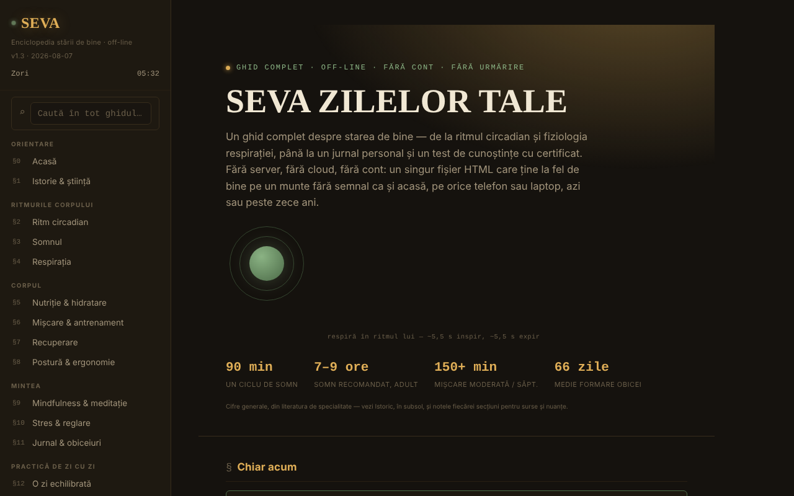

# SEVA — L'encyclopédie du bien-être

[English](README.md) · [Română](README.ro.md) · **Français** · [Italiano](README.it.md) · [Español](README.es.md) · [Português](README.pt.md) · [Deutsch](README.de.md) · [Magyar](README.hu.md)

**Version :** 1.6.0 · **Dernière mise à jour :** 2026-10-19

Langues de l'interface : **Română, English, Français, Italiano, Español, Português (PT), Deutsch, Magyar**

Un guide complet du bien-être, dans un seul fichier HTML, sans compte et sans suivi.

**Application en ligne :** https://chiuta.github.io/SEVA/

## Présentation

SEVA est une encyclopédie interactive (en roumain) sur le sommeil, le rythme circadien, la respiration, la nutrition, le mouvement, la récupération, la posture, la pleine conscience, le stress, le journal et les habitudes, avec des outils pratiques. L'application précise qu'elle ne remplace pas les soins médicaux ou psychologiques et qu'elle offre des références et des outils d'auto-observation, non un diagnostic ni un traitement.

## Fonctionnalités

Le contenu est organisé en sections numérotées (menu latéral, ☰ sur mobile) :

- Orientation : Accueil, Histoire & science.
- Les rythmes du corps : Rythme circadien (cadran interactif dessiné en SVG), Le sommeil, La respiration.
- Le corps : Nutrition & hydratation, Mouvement & entraînement, Récupération, Posture & ergonomie.
- L'esprit : Pleine conscience & méditation, Stress & régulation, Journal & habitudes.
- Pratique au quotidien : Une journée équilibrée, La trousse de bien-être, Calculateurs & outils, Défis & objectifs.
- Ressources : Quand vous avez besoin d'aide, Test de connaissances (avec certificat de réussite), Glossaire A-Z.
- Perspective : Tableau de bord & tendances.
- Confort de lecture dans la barre latérale : taille du texte (A−/A+, 100–150 %), « Texte lisible » (police sans empattement avec espacement accru) et « Contraste » élevé ; le contraste élevé s'active automatiquement si le système le demande (`prefers-contrast: more`). Les réglages n'existent que pendant la session (rien n'est enregistré dans le navigateur).
- Le thème initial suit la préférence du système (`prefers-color-scheme`) ; le raccourci `/` place le focus sur la recherche globale.
- Recherche globale, thème Jour/Nuit, indicateur de « phase du jour », impression de la section courante, « Vérifier l'intégrité du fichier » (SHA-256 du DOM au chargement), « De quoi est fait le fichier » et « Signaler une erreur » (lien GitHub).
- « 🔊 Écouter la section courante » (barre latérale) : lit à voix haute la section ouverte grâce à la synthèse vocale du navigateur (`speechSynthesis`, langue `ro-RO` ; la qualité dépend des voix installées dans le système ; le bouton est masqué si le navigateur ne l'offre pas) ; elle s'arrête à un second appui ou au changement de section. Aucune requête réseau de la part de l'application.
- Le journal, les notes personnelles, la progression de la répétition espacée et le certificat peuvent être exportés/importés sous forme de fichiers JSON.

## Nouveautés (v1.4.0, 14 octobre 2026)

Pas de nouvelle fonction d'apprentissage dans cette version : **la répétition espacée existe déjà** (§17 Test de connaissances, « Mode : Répétition espacée », SM-2 simplifié, avec export/import de la progression) et n'a pas été dupliquée. Le seul ajout est le kit ci-dessous.

### Transparence et sauvegarde (fff-kit)

Un clic (ou Entrée) sur la version affichée (`v 1.4.0 · 2026-10-14`) ouvre la fenêtre « Transparence » : les hôtes réseau déclarés (0 requête externe), les clés de stockage local avec leurs tailles, les API utilisées, la taille et le SHA-256 du fichier (avec un vérificateur pour un fichier téléchargé) et la **sauvegarde** des données de l'application dans un fichier `.fff.json` (éventuellement chiffré par mot de passe, AES-GCM 256 / PBKDF2 ; le mot de passe est irrécupérable), l'import avec confirmation et l'effacement des données de l'application. Le kit (`fff-kit`, modules : core, label, bundle) est intégré dans `index.html`, n'effectue aucune requête réseau et ne modifie pas les données existantes ; sans lui, l'application fonctionne de la même façon. SEVA n'utilise pas `localStorage`, la sauvegarde du kit sera donc (presque) vide ; la progression du test reste exportable via « Exportă progresul » (Exporter la progression). Les textes du kit sont en 8 langues (ro, en, fr, it, es, pt, hu, de) ; **les traductions fr/it/es/pt/hu/de sont automatiques et non vérifiées par des locuteurs natifs**. L'interface de l'application elle-même reste en roumain.

## Mode d'emploi

1. Naviguez depuis le menu latéral (☰ sur téléphone) ou depuis la recherche globale (⌕).
2. Changez de thème avec « ☾ Noapte » (Nuit) / « ☀ Zi » (Jour).
3. Utilisez directement dans la page les sections interactives (le cadran circadien, les exercices de respiration, les calculateurs, le test BOLT, etc.).
4. Dans le §11 Journal & habitudes : le journal ne vit qu'en mémoire tant que la page est ouverte et disparaît au rechargement. Appuyez sur « 💾 Exportă jurnalul (.json) » (Exporter le journal (.json)) pour l'enregistrer sous `seva-jurnal.json` et sur « 📂 Importă » (Importer) pour le recharger lors d'une prochaine visite (il existe aussi « Distribuie fișierul » (Partager le fichier)).
5. Les notes (`seva-notite.json`) et la progression de la répétition espacée (`seva-repetitie-spatiata.json`) s'enregistrent aussi par « 💾 Exportă (.json) » et « 💾 Exportă progresul », et se rechargent par « 📂 Importă » / « 📂 Importă progresul ».
6. Dans le §17 Test de connaissances, saisissez le nom pour le certificat et appuyez sur « Generează certificat » (Générer le certificat) ; le certificat se télécharge sous `seva-certificat.json`.
7. « Printează secțiunea curentă » (Imprimer la section courante) imprime la section ouverte.

## Confidentialité et réseau

- L'application indique explicitement qu'elle n'utilise ni localStorage, ni sessionStorage, ni cookies ; le code ne contient aucun appel à ceux-ci. L'état n'existe qu'en mémoire jusqu'au rechargement, hormis les fichiers que vous exportez vous-même.
- Elle n'effectue aucune requête réseau (ni `fetch`, ni CDN, ni script externe). Elle ne contient que des liens, ouverts au clic : mentalhealthforromania.org, findahelpline.com, antisuicid.ro, who.int, sleepfoundation.org, github.com (signalement d'erreurs), trom.tf et chiuta.github.io.

## Exécution en local / hors ligne

Téléchargez `index.html` et ouvrez-le dans un navigateur ; il n'a pas besoin d'internet (les liens externes ne s'ouvrent qu'au clic).

## Historique / Changelog

### 19 octobre 2026 (v1.5.0)
- L'adresse `#sec=<id>[&from=<slug>]` ouvre directement une section existante (un identifiant inconnu est ignoré). Le contenu n'a pas changé.

### 14 octobre 2026 (v1.4.0)
- fff-kit : fenêtre « Transparence » et sauvegarde unifiée. Le contenu et la répétition espacée n'ont pas changé.

### 12 octobre 2026 (v1.3.4)
- 1.3.4 — 2026-10-12 : la version et la date de la dernière mise à jour sont affichées dans l'application

### 11 octobre 2026 (v1.3.3)
- Nouvelle fonction : « Écouter la section courante » (lecture à voix haute, testée avec une synthèse simulée : démarrage, arrêt, changement de section, fin).
- Cibles tactiles plus grandes pour les liens et les boutons du pied de la barre latérale.

### 11 octobre 2026 (v1.3.2)
- Confort de lecture (taille du texte, texte lisible, contraste élevé), thème initial selon la préférence du système, raccourci `/`, prise en charge de `forced-colors`.
- Correction de l'aspect de la barre d'outils du pied de page (les liens de signalement/impression/intégrité étaient serrés sur une seule ligne) ; les cadrans circadiens rétrécissent sur les écrans étroits.
- CSP : `script-src` avec hachage au lieu de `'unsafe-inline'`.
- Capture d'écran mise à jour.

### 11 octobre 2026 (v1.3.1)
- La recherche globale et le glossaire ignorent désormais les signes diacritiques (« meditatie » trouve « meditație »).
- Accessibilité : barre supérieure mobile en <header>, ordre des titres corrigé (axe : 0 violation).
- Ajout d'une CSP stricte (aucune connexion réseau) ; version 1.3.1 dans l'application.

## Licence

MIT — voir le fichier `LICENSE`. © 2026 Alexandru-Ionuț Chiuță (Alexio). Les éventuelles bibliothèques tierces incluses dans le fichier conservent leurs propres licences.

## Auteur

Alexio — Alexandru-Ionuț Chiuță, contact : alexio@trom.tf

## English summary

SEVA is a single-file Romanian-language encyclopedia of well-being: circadian rhythm, sleep, breathing, nutrition, movement, recovery, posture, mindfulness, stress, habits, with calculators, a journal, a knowledge quiz with a completion certificate and a glossary. It is not medical advice. It has reading-comfort options (text size, readable font, high contrast; session only). It stores nothing in the browser (journal, notes and progress are exported/imported as JSON) and makes no network requests.

## Audit

Audit : 2026-10-10 — vérifié : 0 erreur JS, 0 requête réseau, 0 utilisation de localStorage/sessionStorage/cookies ; axe (WCAG 2.1 AA) exécuté sur toutes les sections, en thème nuit, en thème jour et sur mobile, sans violation serious/critical après les corrections de contraste. Le contenu de santé est informatif et n'a pas été validé médicalement ; le numéro du TelVerde Antisuicid (0800 801 200) et ses horaires peuvent être modifiés par l'opérateur.
