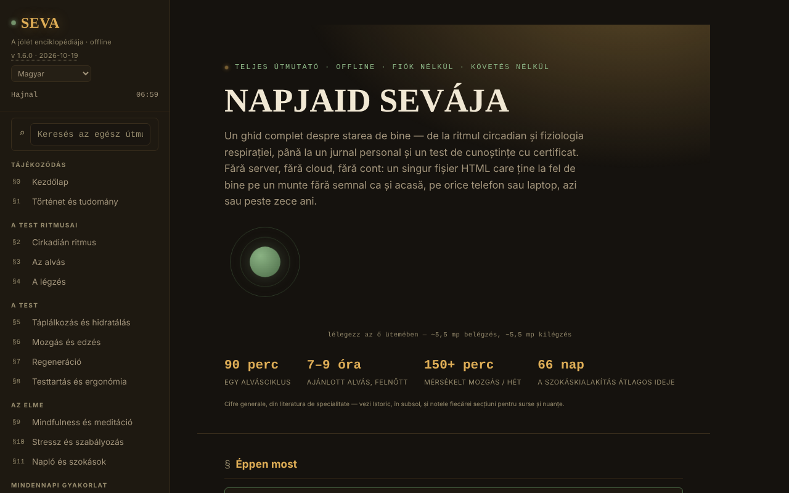

# SEVA — A jóllét enciklopédiája

[English](README.md) · [Română](README.ro.md) · [Français](README.fr.md) · [Italiano](README.it.md) · [Español](README.es.md) · [Português](README.pt.md) · [Deutsch](README.de.md) · **Magyar**

**Verzió:** 1.6.0 · **Utolsó frissítés:** 2026-10-19

A felület nyelvei: **Română, English, Français, Italiano, Español, Português (PT), Deutsch, Magyar**

Teljes útmutató a jólléthez, egyetlen HTML-fájlban, fiók és nyomkövetés nélkül.

**Online alkalmazás:** https://chiuta.github.io/SEVA/

## Mi ez

A SEVA egy interaktív (román nyelvű) enciklopédia az alvásról, a cirkadián ritmusról, a légzésről, a táplálkozásról, a mozgásról, a regenerálódásról, a testtartásról, a mindfulnessről, a stresszről, a naplóírásról és a szokásokról, gyakorlati eszközökkel. Az alkalmazás leszögezi, hogy nem helyettesíti az orvosi vagy pszichológiai ellátást, és referenciát, valamint önmegfigyelési eszközöket kínál, nem diagnózist vagy kezelést.

## Funkciók

A tartalom számozott szakaszokba van szervezve (oldalmenü, mobilon ☰):

- Tájékozódás: Kezdőlap, Történet & tudomány.
- A test ritmusai: Cirkadián ritmus (interaktív, SVG-ben rajzolt számlap), Az alvás, A légzés.
- A test: Táplálkozás & hidratálás, Mozgás & edzés, Regenerálódás, Testtartás & ergonómia.
- Az elme: Mindfulness & meditáció, Stressz & szabályozás, Napló & szokások.
- Mindennapi gyakorlat: Egy kiegyensúlyozott nap, A wellness-készlet, Számológépek & eszközök, Kihívások & célok.
- Források: Amikor segítségre van szükséged, Tudásteszt (teljesítési tanúsítvánnyal), A–Z szószedet.
- Rálátás: Irányítópult & mintázatok.
- Olvasási kényelem az oldalsávban: szövegméret (A−/A+, 100–150%), „Olvasható szöveg” (talpatlan betűtípus megnövelt térközzel) és magas „Kontraszt”; a magas kontraszt automatikusan bekapcsol, ha a rendszer kéri (`prefers-contrast: more`). A beállítások csak a munkamenet idejére léteznek (a böngészőben semmi nem mentődik).
- A kezdeti téma a rendszerbeállítást követi (`prefers-color-scheme`); a `/` billentyűparancs a fókuszt a globális keresőre helyezi.
- Globális keresés, Nappal/Éjszaka téma, „napszak” jelző, az aktuális szakasz nyomtatása, „A fájl épségének ellenőrzése” (a DOM SHA-256 értéke betöltéskor), „Miből áll a fájl” és „Hiba jelentése” (GitHub-hivatkozás).
- „🔊 Az aktuális szakasz meghallgatása” (oldalsáv): a böngésző beszédszintézisével (`speechSynthesis`, nyelv: `ro-RO`; a minőség a rendszerben telepített hangoktól függ; a gomb el van rejtve, ha a böngésző nem kínálja) felolvassa a megnyitott szakaszt; második megnyomásra vagy szakaszváltáskor leáll. Az alkalmazás részéről nincs hálózati kérés.
- A napló, a személyes jegyzetek, az időzített ismétlés előrehaladása és a tanúsítvány JSON-fájlként exportálható/importálható.

## Újdonságok (v1.4.0, 2026. október 14.)

Ebben a verzióban nincs új tanulási funkció: **az időzített ismétlés már létezik** (§17 Tudásteszt, „Mód: Időzített ismétlés”, egyszerűsített SM-2, az előrehaladás exportjával/importjával), és nem lett megkettőzve. Az egyetlen újdonság az alábbi készlet.

### Átláthatóság és biztonsági mentés (fff-kit)

A megjelenített verzióra (`v 1.4.0 · 2026-10-14`) kattintva (vagy Entert nyomva) megnyílik az „Átláthatóság” ablak: a deklarált hálózati gazdák (0 külső kérés), a helyi tárolókulcsok méretekkel, a használt API-k, a fájl mérete és SHA-256 értéke (letöltött fájl ellenőrzőjével), valamint az alkalmazás adatainak **biztonsági mentése** `.fff.json` fájlba (opcionálisan jelszóval titkosítva, AES-GCM 256 / PBKDF2; a jelszó nem állítható vissza), az importálás megerősítéssel és az alkalmazás adatainak törlése. A készlet (`fff-kit`, modulok: core, label, bundle) be van illesztve az `index.html`-be, nem indít hálózati kéréseket, és nem módosítja a meglévő adatokat; nélküle az alkalmazás ugyanúgy működik. A SEVA nem használ `localStorage`-ot, ezért a készlet biztonsági mentése (majdnem) üres lesz; a teszt előrehaladása az „Exportă progresul” (Előrehaladás exportálása) gombbal továbbra is exportálható. A készlet szövegei 8 nyelven vannak (ro, en, fr, it, es, pt, hu, de); **az fr/it/es/pt/hu/de fordítások automatikusak, és anyanyelvi beszélők nem ellenőrizték őket**. Maga az alkalmazás felülete román marad.

## Használati útmutató

1. Navigálj az oldalmenüből (telefonon ☰) vagy a globális keresőből (⌕).
2. Váltsd a témát a „☾ Noapte” (Éjszaka) / „☀ Zi” (Nappal) gombbal.
3. Használd az interaktív szakaszokat (a cirkadián számlapot, a légzőgyakorlatokat, a számológépeket, a BOLT-tesztet stb.) közvetlenül az oldalon.
4. A §11 Napló & szokások résznél: a napló csak a memóriában él, amíg az oldal nyitva van, és újratöltéskor eltűnik. Nyomd meg a „💾 Exportă jurnalul (.json)” (Napló exportálása (.json)) gombot, hogy `seva-jurnal.json` néven mentsd, és a „📂 Importă” (Importálás) gombot, hogy egy következő látogatáskor újra betöltsd (van „Distribuie fișierul” (Fájl megosztása) is).
5. A jegyzetek (`seva-notite.json`) és az időzített ismétlés előrehaladása (`seva-repetitie-spatiata.json`) szintén a „💾 Exportă (.json)” és a „💾 Exportă progresul” gombbal menthetők, és a „📂 Importă” / „📂 Importă progresul” gombbal tölthetők újra.
6. A §17 Tudásteszt résznél add meg a nevet a tanúsítványhoz, és nyomd meg a „Generează certificat” (Tanúsítvány előállítása) gombot; a tanúsítvány `seva-certificat.json` néven töltődik le.
7. A „Printează secțiunea curentă” (Aktuális szakasz nyomtatása) a megnyitott szakaszt nyomtatja.

## Adatvédelem és hálózat

- Az alkalmazás kifejezetten kijelenti, hogy nem használ localStorage-ot, sessionStorage-ot vagy sütiket; a kódban nincsenek rájuk hívások. Az állapot csak a memóriában létezik az újratöltésig, azokon a fájlokon kívül, amelyeket te exportálsz.
- Nem indít hálózati kéréseket (nincs `fetch`, CDN vagy külső szkript). Csak hivatkozásokat tartalmaz, amelyek kattintásra nyílnak meg: mentalhealthforromania.org, findahelpline.com, antisuicid.ro, who.int, sleepfoundation.org, github.com (hibajelentés), trom.tf és chiuta.github.io.

## Helyi / offline futtatás

Töltsd le az `index.html` fájlt, és nyisd meg egy böngészőben; nincs szüksége internetre (a külső hivatkozások csak kattintásra nyílnak meg).

## Előzmények / Changelog

### 2026. október 19. (v1.5.0)
- A `#sec=<id>[&from=<slug>]` cím közvetlenül megnyit egy létező szakaszt (az ismeretlen azonosítót figyelmen kívül hagyja). A tartalom nem változott.

### 2026. október 14. (v1.4.0)
- fff-kit: „Átláthatóság” ablak és egységes biztonsági mentés. A tartalom és az időzített ismétlés nem változott.

### 2026. október 12. (v1.3.4)
- 1.3.4 — 2026-10-12: a verzió és az utolsó frissítés dátuma megjelenik az alkalmazásban

### 2026. október 11. (v1.3.3)
- Új funkció: „Az aktuális szakasz meghallgatása” (felolvasás, szimulált szintézissel tesztelve: indítás, leállítás, szakaszváltás, befejezés).
- Nagyobb érintési felületek az oldalsáv láblécében lévő hivatkozásokhoz és gombokhoz.

### 2026. október 11. (v1.3.2)
- Olvasási kényelem (szövegméret, olvasható szöveg, magas kontraszt), a kezdeti téma a rendszerbeállítás szerint, a `/` billentyűparancs, `forced-colors` támogatás.
- Javítva a lábléc eszköztárának megjelenése (a jelentés/nyomtatás/épség hivatkozások egyetlen sorba voltak zsúfolva); a cirkadián számlapok keskeny képernyőn összezsugorodnak.
- CSP: `script-src` hash-sel az `'unsafe-inline'` helyett.
- Frissített képernyőkép.

### 2026. október 11. (v1.3.1)
- A globális keresés és a szószedet mostantól figyelmen kívül hagyja az ékezeteket (a „meditatie” megtalálja a „meditație” szót).
- Akadálymentesség: a mobil felső sáv <header> elemként, a címsorok sorrendje javítva (axe: 0 szabálysértés).
- Szigorú CSP hozzáadva (hálózati kapcsolatok nélkül); az alkalmazásban a verzió 1.3.1.

## Licenc

MIT — lásd a `LICENSE` fájlt. © 2026 Alexandru-Ionuț Chiuță (Alexio). A fájlba esetleg beillesztett harmadik féltől származó könyvtárak megtartják saját licencüket.

## Szerző

Alexio — Alexandru-Ionuț Chiuță, elérhetőség: alexio@trom.tf

## Összefoglaló
A SEVA egyfájlos, román nyelvű jóllét-enciklopédia: cirkadián ritmus, alvás, légzés, táplálkozás, mozgás, regeneráció, testtartás, mindfulness, stressz, szokások, számológépekkel, naplóval, ismeretkvízzel (teljesítési tanúsítvánnyal) és szószedettel. Nem orvosi tanács. Olvasási kényelmi opciókat kínál (szövegméret, olvasható betűtípus, magas kontraszt; csak a munkamenetre). Nem tárol semmit a böngészőben (a napló, a jegyzetek és a haladás JSON-ként exportálható/importálható), és nem kezdeményez hálózati kéréseket.

## Audit

Audit: 2026-10-10 — ellenőrizve: 0 JS-hiba, 0 hálózati kérés, a localStorage/sessionStorage/sütik 0 használata; az axe (WCAG 2.1 AA) lefuttatva minden szakaszon, éjszakai és nappali témában, valamint mobilon, a kontrasztjavítások után serious/critical szintű szabálysértés nélkül. Az egészségügyi tartalom tájékoztató jellegű, és orvosilag nem validált; az Antisuicid TelVerde száma (0800 801 200) és a nyitvatartása az üzemeltető által módosítható.
