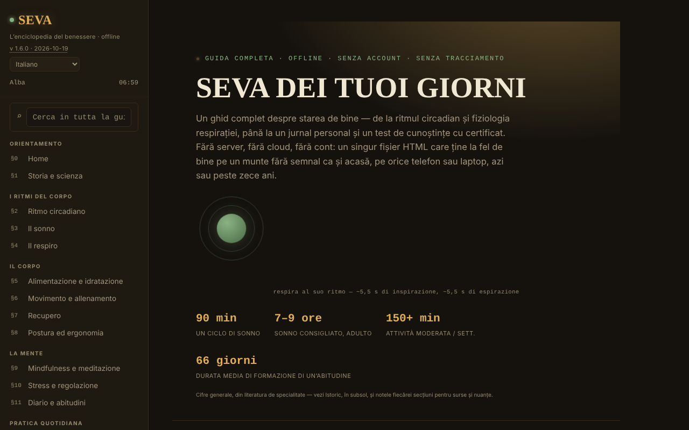

# SEVA — L'enciclopedia del benessere

[English](README.md) · [Română](README.ro.md) · [Français](README.fr.md) · **Italiano** · [Español](README.es.md) · [Português](README.pt.md) · [Deutsch](README.de.md) · [Magyar](README.hu.md)

**Versione:** 1.6.4 · **Ultimo aggiornamento:** 2026-10-22

Lingue dell'interfaccia: **Română, English, Français, Italiano, Español, Português (PT), Deutsch, Magyar**

Una guida completa al benessere, in un unico file HTML, senza account e senza tracciamento.

**App online:** https://chiuta.github.io/SEVA/

## Che cos'è

SEVA è un'enciclopedia interattiva (in 8 lingue) su sonno, ritmo circadiano, respirazione, alimentazione, movimento, recupero, postura, mindfulness, stress, diario e abitudini, con strumenti pratici. L'app precisa che non sostituisce l'assistenza medica o psicologica e che offre riferimenti e strumenti di auto-osservazione, non diagnosi né trattamento.

**Lingue:** tutti i testi lunghi (sezioni, intro, note, cronologia: circa 43.000 caratteri), il glossario e la banca del quiz (226 stringhe) sono disponibili nelle 8 lingue; i nomi propri, i nomi delle lingue e le citazioni/i nomi degli standard restano invariati. Le traduzioni sono automatiche, non verificate da madrelingua; **tutti i contenuti di salute (respirazione, sonno, nutrizione, movimento, stress, risorse di crisi, quiz, glossario) richiedono la revisione di uno specialista**; l'app non sostituisce l'assistenza medica o psicologica.

## Funzioni

Il contenuto è organizzato in sezioni numerate (menu laterale, ☰ su mobile):

- Orientamento: Home, Storia & scienza.
- I ritmi del corpo: Ritmo circadiano (quadrante interattivo disegnato in SVG), Il sonno, La respirazione.
- Il corpo: Alimentazione & idratazione, Movimento & allenamento, Recupero, Postura & ergonomia.
- La mente: Mindfulness & meditazione, Stress & regolazione, Diario & abitudini.
- Pratica quotidiana: Una giornata equilibrata, Il kit del benessere, Calcolatori & strumenti, Sfide & obiettivi.
- Risorse: Quando hai bisogno di aiuto, Test di conoscenze (con attestato di completamento), Glossario A-Z.
- Prospettiva: Cruscotto & schemi.
- Comfort di lettura nella barra laterale: dimensione del testo (A−/A+, 100–150%), «Testo leggibile» (carattere sans-serif con spaziatura aumentata) e «Contrasto» elevato; il contrasto elevato si attiva automaticamente se il sistema lo richiede (`prefers-contrast: more`). Le impostazioni esistono solo per la sessione (nel browser non viene salvato nulla).
- Il tema iniziale segue la preferenza del sistema (`prefers-color-scheme`); la scorciatoia `/` sposta il focus sulla ricerca globale.
- Ricerca globale, tema Giorno/Notte, indicatore della «fase del giorno», stampa della sezione corrente, «Verifica l'integrità del file» (SHA-256 del DOM al caricamento), «Di che cosa è fatto il file» e «Segnala un errore» (link GitHub).
- «🔊 Ascolta la sezione corrente» (barra laterale): legge ad alta voce la sezione aperta tramite la sintesi vocale del browser (`speechSynthesis`, lingua `ro-RO`; la qualità dipende dalle voci installate nel sistema; il pulsante viene nascosto se il browser non la offre); si ferma alla seconda pressione o al cambio di sezione. Nessuna richiesta di rete da parte dell'app.
- Il diario, gli appunti personali, i progressi della ripetizione dilazionata e l'attestato possono essere esportati/importati come file JSON.

## Novità (v1.4.0, 14 ottobre 2026)

Nessuna nuova funzione di apprendimento in questa versione: **la ripetizione dilazionata esiste già** (§17 Test di conoscenze, «Modalità: Ripetizione dilazionata», SM-2 semplificato, con esportazione/importazione dei progressi) e non è stata duplicata. L'unica aggiunta è il kit qui sotto.

### Trasparenza e copia di riserva (fff-kit)

Un clic (o Invio) sulla versione mostrata (`v 1.4.0 · 2026-10-14`) apre la finestra «Trasparenza»: gli host di rete dichiarati (0 richieste esterne), le chiavi di archiviazione locale con le dimensioni, le API utilizzate, la dimensione e lo SHA-256 del file (con un verificatore per un file scaricato) e la **copia di riserva** dei dati dell'app in un file `.fff.json` (facoltativamente cifrato con password, AES-GCM 256 / PBKDF2; la password non è recuperabile), l'importazione con conferma e la cancellazione dei dati dell'app. Il kit (`fff-kit`, moduli: core, label, bundle) è incorporato in `index.html`, non effettua richieste di rete e non modifica i dati esistenti; senza di esso l'app funziona allo stesso modo. SEVA non usa `localStorage`, quindi la copia di riserva del kit sarà (quasi) vuota; i progressi del test restano esportabili tramite «Exportă progresul» (Esporta i progressi). I testi del kit sono in 8 lingue (ro, en, fr, it, es, pt, hu, de); **le traduzioni fr/it/es/pt/hu/de sono automatiche e non verificate da madrelingua**. L'interfaccia e i contenuti dell'app sono disponibili anche nelle 8 lingue (vedi la nota sulle lingue in alto); le traduzioni dei contenuti sono automatiche, non verificate da madrelingua.

## Guida all'uso

1. Naviga dal menu laterale (☰ su telefono) o dalla ricerca globale (⌕).
2. Cambia il tema con «☾ Noapte» (Notte) / «☀ Zi» (Giorno).
3. Usa direttamente nella pagina le sezioni interattive (il quadrante circadiano, gli esercizi di respirazione, i calcolatori, il test BOLT ecc.).
4. Nel §11 Diario & abitudini: il diario vive solo in memoria finché la pagina è aperta e scompare al ricaricamento. Premi «💾 Exportă jurnalul (.json)» (Esporta il diario (.json)) per salvarlo come `seva-jurnal.json` e «📂 Importă» (Importa) per ricaricarlo in una visita futura (esiste anche «Distribuie fișierul» (Condividi il file)).
5. Gli appunti (`seva-notite.json`) e i progressi della ripetizione dilazionata (`seva-repetitie-spatiata.json`) si salvano anch'essi tramite «💾 Exportă (.json)» e «💾 Exportă progresul», e si ricaricano tramite «📂 Importă» / «📂 Importă progresul».
6. Nel §17 Test di conoscenze compila il nome per l'attestato e premi «Generează certificat» (Genera attestato); l'attestato si scarica come `seva-certificat.json`.
7. «Printează secțiunea curentă» (Stampa la sezione corrente) stampa la sezione aperta.

## Privacy e rete

- L'app dichiara esplicitamente di non usare localStorage, sessionStorage né cookie; nel codice non ci sono chiamate a essi. Lo stato esiste solo in memoria fino al ricaricamento, a parte i file che esporti tu.
- Non effettua richieste di rete (niente `fetch`, CDN o script esterni). Contiene solo link, aperti al clic: mentalhealthforromania.org, findahelpline.com, antisuicid.ro, who.int, sleepfoundation.org, github.com (segnalazione di errori), trom.tf e chiuta.github.io.

## Esecuzione in locale / offline

Scarica `index.html` e aprilo in un browser; non richiede internet (i link esterni si aprono solo al clic).

## Cronologia / Changelog

### 1.6.4 — 2026-10-22
- Accessibilità: un solo H1 nella pagina (il titolo della home è un elemento di livello 2 annunciato come livello 1; l'aspetto è invariato).
- Mobile: tutto il testo arriva ad almeno 12 px; i link del piè di pagina e delle fonti hanno un'area di tocco più grande.

### 1.6.3 — 2026-10-22
- Correzione di traduzione: la descrizione (e il nome) nel pannello di trasparenza seguono ora la lingua dell'interfaccia.

### 1.6.2 — 2026-10-22
- Correzioni di traduzione: il titolo della pagina e i meta tag seguono la lingua dell’interfaccia; segnaposto ed etichette delle aree di testo tradotti; rimossa una parola rumena isolata.

### 2026-10-19 (v1.6.1)
- Tutti i testi lunghi, il glossario e la banca del quiz sono tradotti in en, fr, it, es, pt, de, hu (683 nuove righe di dizionario); la frase «i testi lunghi restano in rumeno» è stata rimossa. Il contenuto di salute richiede la revisione di uno specialista.

### 19 ottobre 2026 (v1.5.0)
- L'indirizzo `#sec=<id>[&from=<slug>]` apre direttamente una sezione esistente (un id sconosciuto viene ignorato). Il contenuto non è cambiato.

### 14 ottobre 2026 (v1.4.0)
- fff-kit: finestra «Trasparenza» e copia di riserva unificata. Il contenuto e la ripetizione dilazionata non sono cambiati.

### 12 ottobre 2026 (v1.3.4)
- 1.3.4 — 2026-10-12: la versione e la data dell'ultimo aggiornamento sono mostrate nell'app

### 11 ottobre 2026 (v1.3.3)
- Nuova funzione: «Ascolta la sezione corrente» (lettura ad alta voce, testata con sintesi simulata: avvio, arresto, cambio di sezione, termine).
- Aree di tocco più grandi per i link e i pulsanti nel piè di pagina della barra laterale.

### 11 ottobre 2026 (v1.3.2)
- Comfort di lettura (dimensione del testo, testo leggibile, contrasto elevato), tema iniziale secondo la preferenza del sistema, scorciatoia `/`, supporto `forced-colors`.
- Corretto l'aspetto della barra degli strumenti del piè di pagina (i link di segnalazione/stampa/integrità erano compressi su un'unica riga); i quadranti circadiani si riducono sugli schermi stretti.
- CSP: `script-src` con hash al posto di `'unsafe-inline'`.
- Schermata aggiornata.

### 11 ottobre 2026 (v1.3.1)
- La ricerca globale e il glossario ora ignorano i segni diacritici («meditatie» trova «meditație»).
- Accessibilità: barra superiore mobile come <header>, ordine dei titoli corretto (axe: 0 violazioni).
- Aggiunta una CSP rigorosa (nessuna connessione di rete); versione 1.3.1 nell'app.

## Licenza

MIT — vedi il file `LICENSE`. © 2026 Alexandru-Ionuț Chiuță (Alexio). Eventuali librerie di terze parti incluse nel file mantengono le proprie licenze.

## Autore

Alexio — Alexandru-Ionuț Chiuță, contatto: alexio@trom.tf

## Riepilogo

SEVA è un'enciclopedia del benessere in un unico file, in 8 lingue: ritmo circadiano, sonno, respirazione, alimentazione, movimento, recupero, postura, mindfulness, stress, abitudini, con calcolatori, un diario, un quiz di conoscenze con attestato di completamento e un glossario. Non costituisce consulenza medica. Offre opzioni di comfort di lettura (dimensione del testo, carattere leggibile, alto contrasto; solo per la sessione). Non memorizza nulla nel browser (diario, note e progressi si esportano/importano come JSON) e non effettua richieste di rete.

## Audit

Audit: 2026-10-10 — verificato: 0 errori JS, 0 richieste di rete, 0 usi di localStorage/sessionStorage/cookie; axe (WCAG 2.1 AA) eseguito su tutte le sezioni, nel tema notte, nel tema giorno e su mobile, senza violazioni serious/critical dopo le correzioni di contrasto. Il contenuto sulla salute è informativo e non è stato validato dal punto di vista medico; il numero del TelVerde Antisuicid (0800 801 200) e il suo orario possono essere modificati dall'operatore.
