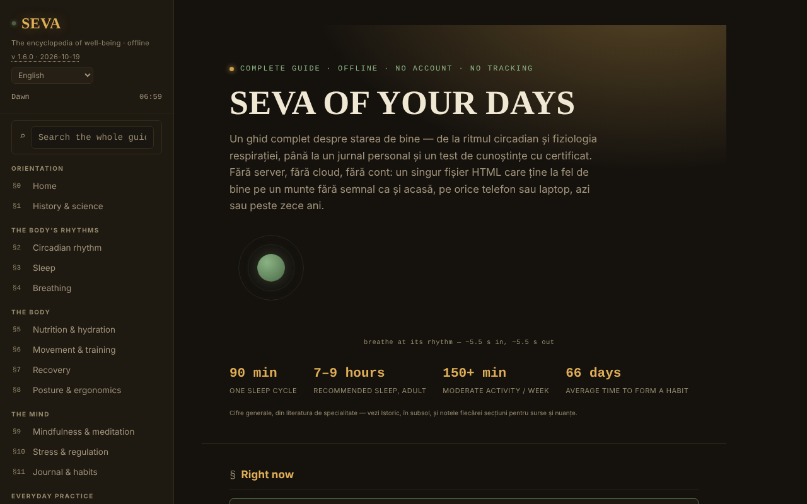

# SEVA — The Encyclopedia of Well-Being

**English** · [Română](README.ro.md) · [Français](README.fr.md) · [Italiano](README.it.md) · [Español](README.es.md) · [Português](README.pt.md) · [Deutsch](README.de.md) · [Magyar](README.hu.md)

**Version:** 1.6.10 · **Last updated:** 2026-10-26

Interface languages: **Română, English, Français, Italiano, Español, Português (PT), Deutsch, Magyar**

A complete guide to well-being, in a single HTML file, with no account and no tracking.

**Live app:** https://chiuta.github.io/SEVA/

## What it is

SEVA is an interactive encyclopedia (in 8 languages) about sleep, circadian rhythm, breathing, nutrition, movement, recovery, posture, mindfulness, stress, journaling and habits, with practical tools. The app states that it does not replace medical or psychological care and that it offers reference material and self-observation tools, not diagnosis or treatment.

**Languages:** all the long texts (sections, intro, notes, history: about 43,000 characters), the glossary and the quiz bank (226 strings) are available in the 8 languages; proper names, language names and quotations/names of standards remain as they are. The translations are automatic and not verified by native speakers; **all the health content (breathing, sleep, nutrition, movement, stress, crisis resources, quiz, glossary) needs specialist review**; the app does not replace medical or psychological care.

## Features

The content is organized in numbered sections (side menu, ☰ on mobile):

- Orientation: Home, History & science.
- Body rhythms: Circadian rhythm (interactive dial drawn in SVG), Sleep, Breathing.
- The body: Nutrition & hydration, Movement & training, Recovery, Posture & ergonomics.
- The mind: Mindfulness & meditation, Stress & regulation, Journal & habits.
- Everyday practice: A balanced day, The wellness kit, Calculators & tools, Challenges & goals.
- Resources: When you need help, Knowledge quiz (with a completion certificate), A–Z glossary.
- Perspective: Dashboard & patterns.
- Reading comfort in the sidebar: text size (A−/A+, 100–150%), "Readable text" (sans-serif font with increased spacing) and high "Contrast"; high contrast is activated automatically if the system requests it (`prefers-contrast: more`). The settings exist only for the session (nothing is saved in the browser).
- The initial theme follows the system preference (`prefers-color-scheme`); the `/` shortcut moves focus to the global search.
- Global search, Day/Night theme, a "phase of the day" indicator, printing the current section, "Verify file integrity" (SHA-256 of the DOM at load time), "What the file is made of" and "Report an error" (GitHub link).
- "🔊 Listen to the current section" (sidebar): reads the open section aloud through the browser's speech synthesis (`speechSynthesis`, language `ro-RO`; quality depends on the voices installed in the system; the button is hidden if the browser does not provide it); it stops on a second press or when the section changes. No network requests from the app.
- The journal, personal notes, spaced-repetition progress and the certificate can be exported/imported as JSON files.

## New features (v1.4.0, 14 October 2026)

No new learning features in this version: **spaced repetition already exists** (§17 Knowledge quiz, "Mode: Spaced repetition", simplified SM-2, with progress export/import) and was not duplicated. The only addition is the kit below.

### Transparency and backup (fff-kit)

A click (or Enter) on the displayed version (`v 1.4.0 · 2026-10-14`) opens the "Transparency" window: the declared network hosts (0 external requests), the local storage keys with sizes, the APIs used, the size and SHA-256 of the file (with a verifier for a downloaded file) and the **backup** of the app's data to a `.fff.json` file (optionally encrypted with a password, AES-GCM 256 / PBKDF2; the password cannot be recovered), import with confirmation, and deletion of the app's data. The kit (`fff-kit`, modules: core, label, bundle) is pasted into `index.html`, makes no network requests and does not change existing data; without it the app works the same. SEVA does not use `localStorage`, so the kit's backup will be (almost) empty; the quiz progress remains exportable through "Exportă progresul" (Export progress). The kit's texts are in 8 languages (ro, en, fr, it, es, pt, hu, de); **the fr/it/es/pt/hu/de translations are automatic and not checked by native speakers**. The app's own interface and content are also available in the 8 languages (see the language note near the top); the content translations are automatic and not verified by native speakers.

## User guide

1. Navigate from the side menu (☰ on a phone) or from the global search (⌕).
2. Switch the theme with "☾ Noapte" (Night) / "☀ Zi" (Day).
3. Use the interactive sections (the circadian dial, the breathing exercises, the calculators, the BOLT test etc.) directly on the page.
4. In §11 Journal & habits: the journal lives only in memory while the page is open and disappears on reload. Press "💾 Exportă jurnalul (.json)" (Export the journal (.json)) to save it as `seva-jurnal.json` and "📂 Importă" (Import) to reload it in a future visit (there is also "Distribuie fișierul" (Share the file)).
5. The notes (`seva-notite.json`) and the spaced-repetition progress (`seva-repetitie-spatiata.json`) are also saved through "💾 Exportă (.json)" and "💾 Exportă progresul", and reloaded through "📂 Importă" / "📂 Importă progresul".
6. In §17 Knowledge quiz, fill in the name for the certificate and press "Generează certificat" (Generate certificate); the certificate downloads as `seva-certificat.json`.
7. "Printează secțiunea curentă" (Print the current section) prints the open section.

## Privacy and network

- The app states explicitly that it does not use localStorage, sessionStorage or cookies; there are no calls to them in the code. State exists only in memory until reload, apart from the files you export yourself.
- It makes no network requests (no `fetch`, CDN or external scripts). It contains only links, opened on click: mentalhealthforromania.org, findahelpline.com, antisuicid.ro, who.int, sleepfoundation.org, github.com (error reporting), trom.tf and chiuta.github.io.

## Running locally / offline

Download `index.html` and open it in a browser; it needs no internet (external links open only on click).

## History / Changelog

### 1.6.9 — 2026-10-23

- Touch targets of at least 44 px on touch devices (`pointer:coarse`); desktop is unchanged.

### 1.6.7 — 2026-10-22

fff-kit 1.1.4: touch targets and minimum text size; touch targets and text size corrected.

### 1.6.6 — 2026-10-22
- Accessibility: the search field now shows a clear focus ring (contrast of at least 3:1) in both the night and day themes.

### 1.6.5 — 2026-10-22
- fff-kit 1.1.2: PBKDF2 600,000 iterations, anti-clickjacking protection

### 1.6.4 — 2026-10-22
- Accessibility: exactly one H1 in the page (the home title is now a level-2 element announced as level 1; the look is unchanged).
- Mobile: all text raised to at least 12 px; footer links and the source links have a larger tap area.

### 1.6.3 — 2026-10-22
- Translation fix: the description (and name) in the transparency panel now follow the interface language.

### 1.6.2 — 2026-10-22
- Translation fixes: page title and meta tags follow the interface language; placeholders and labels of text areas are translated; an isolated Romanian word removed.

### 2026-10-19 (v1.6.1)
- All the long texts, the glossary and the quiz bank are translated into en, fr, it, es, pt, de, hu (683 new dictionary rows); the line "the long texts remain in Romanian" was removed. The health content needs specialist review.

### 19 October 2026 (v1.5.0)
- The address `#sec=<id>[&from=<slug>]` directly opens an existing section (an unknown id is ignored). The content did not change.

### 14 October 2026 (v1.4.0)
- fff-kit: the "Transparency" window and unified backup. The content and the spaced repetition did not change.

### 12 October 2026 (v1.3.4)
- 1.3.4 — 2026-10-12: the version and the date of the last update are shown in the app

### 11 October 2026 (v1.3.3)
- New feature: "Listen to the current section" (reading aloud, tested with simulated synthesis: start, stop, section change, end).
- Larger touch targets for the links and buttons in the sidebar footer.

### 11 October 2026 (v1.3.2)
- Reading comfort (text size, readable text, high contrast), initial theme following the system preference, the `/` shortcut, `forced-colors` support.
- Fixed the layout of the footer toolbar (the report/print/integrity links were squeezed onto a single row); the circadian dials shrink on narrow screens.
- CSP: `script-src` with a hash instead of `'unsafe-inline'`.
- Updated screenshot.

### 11 October 2026 (v1.3.1)
- Global search and the glossary now ignore diacritics ("meditatie" finds "meditație").
- Accessibility: mobile top bar as <header>, heading order fixed (axe: 0 violations).
- Added a strict CSP (no network connections); in-app version 1.3.1.

## License

MIT — see the `LICENSE` file. © 2026 Alexandru-Ionuț Chiuță (Alexio). Any third-party libraries included in the file keep their own licenses.

## Author

Alexio — Alexandru-Ionuț Chiuță, contact: alexio@trom.tf

## English summary

SEVA is a single-file 8-language encyclopedia of well-being: circadian rhythm, sleep, breathing, nutrition, movement, recovery, posture, mindfulness, stress, habits, with calculators, a journal, a knowledge quiz with a completion certificate and a glossary. It is not medical advice. It has reading-comfort options (text size, readable font, high contrast; session only). It stores nothing in the browser (journal, notes and progress are exported/imported as JSON) and makes no network requests.

## Audit

Audit: 2026-10-10 — verified: 0 JS errors, 0 network requests, 0 uses of localStorage/sessionStorage/cookies; axe (WCAG 2.1 AA) run on all sections, in the night theme, the day theme and on mobile, with no serious/critical violations after the contrast fixes. The health content is informational and has not been medically validated; the number of the Antisuicid TelVerde line (0800 801 200) and its schedule may be changed by the operator.
