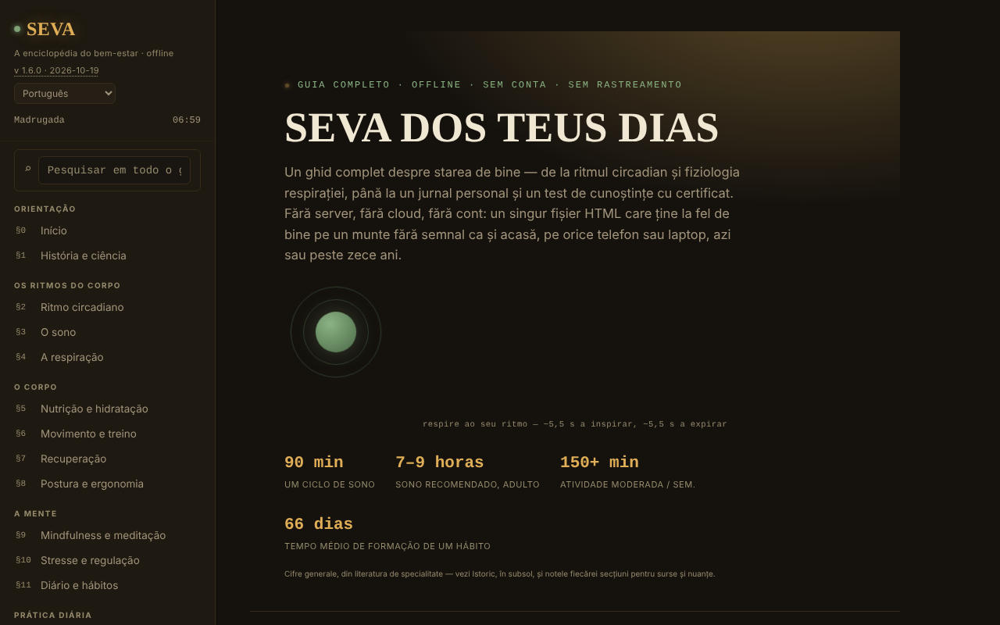

# SEVA — A enciclopédia do bem-estar

[English](README.md) · [Română](README.ro.md) · [Français](README.fr.md) · [Italiano](README.it.md) · [Español](README.es.md) · **Português** · [Deutsch](README.de.md) · [Magyar](README.hu.md)

**Versão:** 1.6.0 · **Última atualização:** 2026-10-19

Idiomas da interface: **Română, English, Français, Italiano, Español, Português (PT), Deutsch, Magyar**

Um guia completo sobre o bem-estar, num único ficheiro HTML, sem conta e sem rastreamento.

**Aplicação online:** https://chiuta.github.io/SEVA/

## O que é

O SEVA é uma enciclopédia interativa (em romeno) sobre o sono, o ritmo circadiano, a respiração, a nutrição, o movimento, a recuperação, a postura, o mindfulness, o stresse, o diário e os hábitos, com ferramentas práticas. A aplicação esclarece que não substitui os cuidados médicos ou psicológicos e que oferece referência e ferramentas de autoobservação, não diagnóstico nem tratamento.

## Funcionalidades

O conteúdo está organizado em secções numeradas (menu lateral, ☰ no telemóvel):

- Orientação: Início, História & ciência.
- Os ritmos do corpo: Ritmo circadiano (mostrador interativo desenhado em SVG), O sono, A respiração.
- O corpo: Nutrição & hidratação, Movimento & treino, Recuperação, Postura & ergonomia.
- A mente: Mindfulness & meditação, Stresse & regulação, Diário & hábitos.
- Prática diária: Um dia equilibrado, O kit de bem-estar, Calculadoras & ferramentas, Desafios & objetivos.
- Recursos: Quando precisa de ajuda, Teste de conhecimentos (com certificado de conclusão), Glossário A-Z.
- Perspetiva: Painel de controlo & padrões.
- Conforto de leitura na barra lateral: tamanho do texto (A−/A+, 100–150 %), «Texto legível» (tipo de letra sem serifa com espaçamento aumentado) e «Contraste» elevado; o contraste elevado ativa-se automaticamente se o sistema o solicitar (`prefers-contrast: more`). As definições existem apenas durante a sessão (nada é guardado no navegador).
- O tema inicial segue a preferência do sistema (`prefers-color-scheme`); o atalho `/` move o foco para a pesquisa global.
- Pesquisa global, tema Dia/Noite, indicador da «fase do dia», impressão da secção atual, «Verificar a integridade do ficheiro» (SHA-256 do DOM ao carregar), «De que é feito o ficheiro» e «Comunicar um erro» (ligação para o GitHub).
- «🔊 Ouvir a secção atual» (barra lateral): lê em voz alta a secção aberta através da síntese de voz do navegador (`speechSynthesis`, idioma `ro-RO`; a qualidade depende das vozes instaladas no sistema; o botão fica oculto se o navegador não a oferecer); pára ao premir pela segunda vez ou ao mudar de secção. Sem pedidos de rede por parte da aplicação.
- O diário, as notas pessoais, o progresso da repetição espaçada e o certificado podem ser exportados/importados como ficheiros JSON.

## Novidades (v1.4.0, 14 de outubro de 2026)

Sem novas funcionalidades de aprendizagem nesta versão: **a repetição espaçada já existe** (§17 Teste de conhecimentos, «Modo: Repetição espaçada», SM-2 simplificado, com exportação/importação do progresso) e não foi duplicada. O único acréscimo é o kit descrito abaixo.

### Transparência e cópia de segurança (fff-kit)

Um clique (ou Enter) na versão apresentada (`v 1.4.0 · 2026-10-14`) abre a janela «Transparência»: os anfitriões de rede declarados (0 pedidos externos), as chaves de armazenamento local com os tamanhos, as APIs utilizadas, o tamanho e o SHA-256 do ficheiro (com um verificador para um ficheiro descarregado) e a **cópia de segurança** dos dados da aplicação num ficheiro `.fff.json` (opcionalmente cifrado com palavra-passe, AES-GCM 256 / PBKDF2; a palavra-passe não pode ser recuperada), a importação com confirmação e o apagamento dos dados da aplicação. O kit (`fff-kit`, módulos: core, label, bundle) está integrado no `index.html`, não faz pedidos de rede e não altera os dados existentes; sem ele, a aplicação funciona da mesma forma. O SEVA não usa `localStorage`, pelo que a cópia de segurança do kit ficará (quase) vazia; o progresso do teste continua exportável através de «Exportă progresul» (Exportar o progresso). Os textos do kit estão em 8 idiomas (ro, en, fr, it, es, pt, hu, de); **as traduções fr/it/es/pt/hu/de são automáticas e não foram verificadas por falantes nativos**. A interface da própria aplicação continua em romeno.

## Manual de utilização

1. Navegue a partir do menu lateral (☰ no telemóvel) ou da pesquisa global (⌕).
2. Mude o tema com «☾ Noapte» (Noite) / «☀ Zi» (Dia).
3. Use diretamente na página as secções interativas (o mostrador circadiano, os exercícios de respiração, as calculadoras, o teste BOLT, etc.).
4. No §11 Diário & hábitos: o diário vive apenas em memória enquanto a página está aberta e desaparece ao recarregar. Prima «💾 Exportă jurnalul (.json)» (Exportar o diário (.json)) para o guardar como `seva-jurnal.json` e «📂 Importă» (Importar) para o recarregar numa visita futura (existe também «Distribuie fișierul» (Partilhar o ficheiro)).
5. As notas (`seva-notite.json`) e o progresso da repetição espaçada (`seva-repetitie-spatiata.json`) guardam-se também através de «💾 Exportă (.json)» e «💾 Exportă progresul», e recarregam-se através de «📂 Importă» / «📂 Importă progresul».
6. No §17 Teste de conhecimentos, preencha o nome para o certificado e prima «Generează certificat» (Gerar certificado); o certificado é descarregado como `seva-certificat.json`.
7. «Printează secțiunea curentă» (Imprimir a secção atual) imprime a secção aberta.

## Privacidade e rede

- A aplicação declara explicitamente que não usa localStorage, sessionStorage nem cookies; no código não há chamadas a estes. O estado existe apenas em memória até ao recarregamento, à parte os ficheiros que o utilizador exporta.
- Não faz pedidos de rede (sem `fetch`, CDN ou scripts externos). Contém apenas ligações, abertas ao clicar: mentalhealthforromania.org, findahelpline.com, antisuicid.ro, who.int, sleepfoundation.org, github.com (comunicação de erros), trom.tf e chiuta.github.io.

## Execução local / offline

Descarregue `index.html` e abra-o num navegador; não requer internet (as ligações externas só se abrem ao clicar).

## Histórico / Changelog

### 19 de outubro de 2026 (v1.5.0)
- O endereço `#sec=<id>[&from=<slug>]` abre diretamente uma secção existente (um id desconhecido é ignorado). O conteúdo não mudou.

### 14 de outubro de 2026 (v1.4.0)
- fff-kit: janela «Transparência» e cópia de segurança unificada. O conteúdo e a repetição espaçada não mudaram.

### 12 de outubro de 2026 (v1.3.4)
- 1.3.4 — 2026-10-12: a versão e a data da última atualização são apresentadas na aplicação

### 11 de outubro de 2026 (v1.3.3)
- Funcionalidade nova: «Ouvir a secção atual» (leitura em voz alta, testada com síntese simulada: início, paragem, mudança de secção, conclusão).
- Áreas de toque maiores para as ligações e os botões do rodapé da barra lateral.

### 11 de outubro de 2026 (v1.3.2)
- Conforto de leitura (tamanho do texto, texto legível, contraste elevado), tema inicial segundo a preferência do sistema, atalho `/`, suporte de `forced-colors`.
- Corrigido o aspeto da barra de ferramentas do rodapé (as ligações de comunicação/impressão/integridade estavam apertadas numa única linha); os mostradores circadianos encolhem em ecrãs estreitos.
- CSP: `script-src` com hash em vez de `'unsafe-inline'`.
- Captura de ecrã atualizada.

### 11 de outubro de 2026 (v1.3.1)
- A pesquisa global e o glossário passam a ignorar os sinais diacríticos («meditatie» encontra «meditație»).
- Acessibilidade: barra superior móvel como <header>, ordem dos títulos corrigida (axe: 0 violações).
- Adicionada uma CSP estrita (sem ligações de rede); versão 1.3.1 na aplicação.

## Licença

MIT — ver o ficheiro `LICENSE`. © 2026 Alexandru-Ionuț Chiuță (Alexio). As eventuais bibliotecas de terceiros incluídas no ficheiro mantêm as suas próprias licenças.

## Autor

Alexio — Alexandru-Ionuț Chiuță, contacto: alexio@trom.tf

## Resumo

A SEVA é uma enciclopédia do bem-estar em romeno, num único ficheiro: ritmo circadiano, sono, respiração, nutrição, movimento, recuperação, postura, atenção plena, stresse, hábitos, com calculadoras, um diário, um questionário de conhecimentos com certificado de conclusão e um glossário. Não constitui aconselhamento médico. Tem opções de conforto de leitura (tamanho do texto, tipo de letra legível, contraste elevado; apenas durante a sessão). Não guarda nada no navegador (o diário, as notas e o progresso são exportados/importados em JSON) e não faz pedidos de rede.

## Auditoria

Auditoria: 2026-10-10 — verificado: 0 erros de JS, 0 pedidos de rede, 0 utilizações de localStorage/sessionStorage/cookies; axe (WCAG 2.1 AA) executado em todas as secções, no tema noite, no tema dia e em telemóvel, sem violações serious/critical após as correções de contraste. O conteúdo de saúde é informativo e não foi validado medicamente; o número do TelVerde Antisuicid (0800 801 200) e o seu horário podem ser alterados pelo operador.
