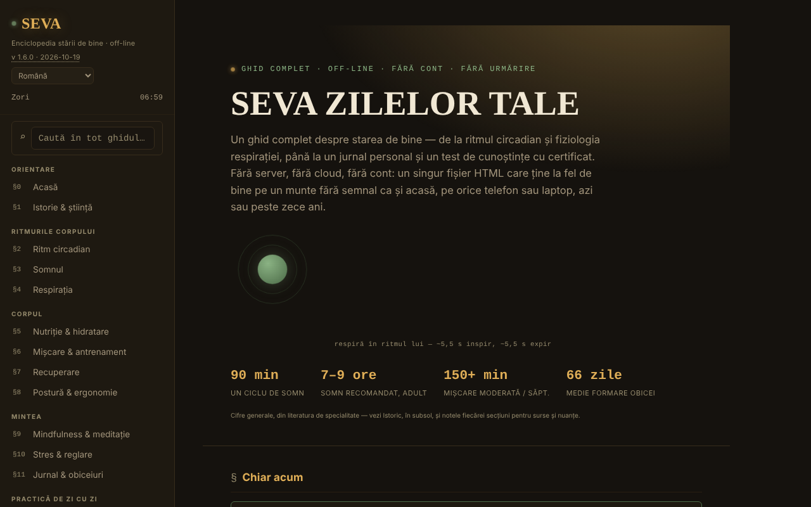

# SEVA — Enciclopedia stării de bine

[English](README.md) · **Română** · [Français](README.fr.md) · [Italiano](README.it.md) · [Español](README.es.md) · [Português](README.pt.md) · [Deutsch](README.de.md) · [Magyar](README.hu.md)

**Versiune:** 2.1.0 · **Ultima actualizare:** 2026-10-27

**Stare:** experimental (conținut de sănătate nerevizuit de un specialist) · **Offline:** complet (fără cereri de rețea; sursele sunt linkuri deschise la click)

Limbile interfeței: **Română, English, Français, Italiano, Español, Português (PT), Deutsch, Magyar**

Ghid complet despre starea de bine, într-un singur fișier HTML, fără cont și fără urmărire.

**Live:** https://chiuta.github.io/SEVA/

## Ce este

SEVA este o enciclopedie interactivă (în 8 limbi) despre somn, ritm circadian, respirație, nutriție, mișcare, recuperare, postură, mindfulness, stres, jurnal și obiceiuri, cu unelte practice. Aplicația precizează că nu înlocuiește îngrijirea medicală sau psihologică și că oferă referință și unelte de auto-observare, nu diagnostic sau tratament.

**Limbi:** toate textele lungi (secțiuni, intro, note, istoric: circa 43.000 de caractere), glosarul și banca de quiz (226 de șiruri) sunt disponibile în cele 8 limbi; numele proprii, numele limbilor și citatele/denumirile standardelor rămân neschimbate. Traducerile sunt automate, neverificate de vorbitori nativi; **tot conținutul de sănătate (respirație, somn, nutriție, mișcare, stres, resurse de criză, quiz, glosar) necesită revizie de specialitate**; aplicația nu înlocuiește îngrijirea medicală sau psihologică.

## Funcții

Conținutul este organizat în secțiuni numerotate (meniu lateral, ☰ pe mobil):

- Orientare: Acasă, Istorie & știință.
- Ritmurile corpului: Ritm circadian (cadran interactiv desenat în SVG), Somnul, Respirația.
- Corpul: Nutriție & hidratare, Mișcare & antrenament, Recuperare, Postură & ergonomie.
- Mintea: Mindfulness & meditație, Stres & reglare, Jurnal & obiceiuri.
- Practică de zi cu zi: O zi echilibrată, Trusa de wellness, Calculatoare & unelte, Provocări & obiective.
- Resurse: Când ai nevoie de ajutor, Test de cunoștințe (cu certificat de finalizare), Glosar A-Z.
- Perspectivă: Tablou de bord & tipare.
- Confort de citire în bara laterală: mărime text (A−/A+, 100–150%), „Text lizibil” (font sans-serif cu spațiere mărită) și „Contrast” ridicat; se activează automat contrastul ridicat dacă sistemul îl cere (`prefers-contrast: more`). Setările există doar în sesiune (nu se salvează nimic în browser).
- Tema inițială urmează preferința sistemului (`prefers-color-scheme`); scurtătura `/` mută focusul pe căutarea globală.
- Căutare globală, temă Zi/Noapte, indicator „faza zilei", tipărirea secțiunii curente, „Verifică integritatea fișierului" (SHA-256 al DOM-ului la încărcare), „Din ce e făcut fișierul" și „Raportează o eroare" (link GitHub).
- „🔊 Ascultă secțiunea curentă” (bara laterală): citește cu voce tare secțiunea deschisă prin sinteza vocală a browserului (`speechSynthesis`, limba `ro-RO`; calitatea depinde de vocile instalate în sistem; butonul se ascunde dacă browserul nu o oferă); se oprește la a doua apăsare sau la schimbarea secțiunii. Fără cereri de rețea din partea aplicației.
- Jurnalul, notițele personale, progresul de repetiție spațiată și certificatul se pot exporta/importa ca fișiere JSON.

## Jurnal de somn și ritm (v2.0.0)

În §11, jurnalul primește ora de culcare, ora de trezire și energia peste zi (1–5). Din intrările cu ore, SEVA calculează local durata medie, regularitatea orei de culcare, diferența dintre weekend și restul săptămânii și (la 6+ intrări) energia după nopți mai lungi vs. mai scurte, apoi trimite spre secțiunile potrivite din ghid. Sunt tipare descriptive din datele tale, cu praguri orientative: nu sunt diagnostic. Datele rămân doar în memorie (ca tot jurnalul) și se exportă/importă în `seva-jurnal.json`.

## Funcții noi (v1.4.0, 14 octombrie 2026)

Fără funcții de învățare noi în această versiune: **repetiția spațiată există deja** (§17 Test de cunoștințe, „Mod: Repetiție spațiată”, SM-2 simplificat, cu export/import al progresului) și nu a fost dublată. Singura adăugire este kitul de mai jos.

### Transparență și copie de siguranță (fff-kit)

Un clic (sau Enter) pe versiunea afișată (`v 1.4.0 · 2026-10-14`) deschide fereastra „Transparență”: gazdele de rețea declarate (0 cereri externe), cheile de stocare locală cu dimensiuni, API-urile folosite, mărimea și SHA-256 al fișierului (cu verificator pentru un fișier descărcat) și **copia de siguranță** a datelor aplicației într-un fișier `.fff.json` (opțional criptat cu parolă, AES-GCM 256 / PBKDF2; parola nu poate fi recuperată), import cu confirmare și ștergerea datelor aplicației. Kitul (`fff-kit`, module: core, label, bundle) este lipit în `index.html`, nu face cereri de rețea și nu schimbă datele existente; fără el aplicația funcționează la fel. SEVA nu folosește `localStorage`, deci copia de siguranță a kitului va fi (aproape) goală; progresul testului rămâne exportabil prin „Exportă progresul”. Textele kitului sunt în 8 limbi (ro, en, fr, it, es, pt, hu, de); **traducerile fr/it/es/pt/hu/de sunt automate și neverificate nativ**. Interfața și conținutul aplicației sunt disponibile și în cele 8 limbi (vezi nota despre limbi de la început); traducerile conținutului sunt automate, neverificate de vorbitori nativi.

## Manual de utilizare

1. Navighează din meniul lateral (☰ pe telefon) sau din căutarea globală (⌕).
2. Comută tema cu „☾ Noapte" / „☀ Zi".
3. Folosește secțiunile interactive (cadranul circadian, exercițiile de respirație, calculatoarele, testul BOLT etc.) direct în pagină.
4. În §11 Jurnal & obiceiuri: jurnalul trăiește doar în memorie cât timp pagina e deschisă și dispare la reîncărcare. Apasă „💾 Exportă jurnalul (.json)" pentru a-l salva ca `seva-jurnal.json` și „📂 Importă" pentru a-l reîncărca într-o vizită viitoare (există și „Distribuie fișierul").
5. Notițele (`seva-notite.json`) și progresul de repetiție spațiată (`seva-repetitie-spatiata.json`) se salvează tot prin „💾 Exportă (.json)" și „💾 Exportă progresul", iar reîncărcarea prin „📂 Importă" / „📂 Importă progresul".
6. În §17 Test de cunoștințe completează numele pentru certificat și apasă „Generează certificat"; certificatul se descarcă ca `seva-certificat.json`.
7. „Printează secțiunea curentă" tipărește secțiunea deschisă.

## Confidențialitate și rețea

- Aplicația spune explicit că nu folosește localStorage, sessionStorage sau cookies; în cod nu există apeluri către acestea. Starea există doar în memorie până la reîncărcare, în afară de fișierele pe care le exporți tu.
- Nu face cereri de rețea (fără `fetch`, CDN sau scripturi externe). Conține doar link-uri, deschise la click: mentalhealthforromania.org, findahelpline.com, antisuicid.ro, who.int, sleepfoundation.org, github.com (raportare erori), trom.tf și chiuta.github.io.

## Rulare locală / offline

Descarcă `index.html` și deschide-l în browser; nu necesită internet (link-urile externe se deschid doar la click).

## Surse pe secțiuni și data revizuirii (2.0.1, 2026-10-27)

- Fiecare dintre cele 20 de secțiuni are acum, la final, un bloc **„Surse și revizuire”** (în 8 limbi). Sursele sunt doar cele **verificate pe web la 2026-10-27**: OMS (Constituția OMS; fișa „Healthy diet”; ghidurile OMS privind activitatea fizică și sedentarismul; „Doing What Matters in Times of Stress”), AASM/SRS (Watson și colab., 2015, durata somnului la adult), Premiul Nobel 2017 (ritm circadian), Selye (1936, *Nature*), Kabat-Zinn (1982) și Lally și colab. (2010, formarea obiceiurilor). Sursele sunt **de context general și nu acoperă fiecare afirmație** din secțiune.
- Secțiunile fără o sursă verificată (respirație, recuperare, postură, o zi echilibrată, trusa de wellness, calculatoare, provocări, test, glosar) afișează explicit **„Surse: de completat”**; tabloul de bord este marcat ca derivat din datele tale. **Nu au fost inventate surse.**
- **Data:** „Ultima actualizare a listei de surse: 2026-10-27” datează **doar adăugarea acestor liste**. **Nu există o revizuire a conținutului de către un specialist** și aplicația spune asta în fiecare bloc.
- **De verificat (semnalat în aplicație):** secțiunea Somn dă „7–9 ore”, dar sursa citată (Watson și colab., 2015) recomandă „7 ore sau mai mult”. Numerele și programele din „Când ai nevoie de ajutor” nu au fost reverificate la această actualizare.
- Textul conținutului medical nu a fost modificat. Sursele sunt linkuri deschise doar la click; aplicația rămâne fără cereri de rețea.

## Surse completate pentru patru secțiuni (2.1.0, 2026-10-27)

- **Respirația:** NHS, „Breathing exercises for stress” (nhs.uk; ultima revizuire după pagină: 12 iunie 2026). **Recuperarea:** NHS inform (Scoția), „Pain and injuries after exercise” (pagina indică ultima actualizare: 29 aprilie 2024). **Postura** și **O zi echilibrată:** Bull F.C. et al. (2020), ghidurile OMS 2020 privind activitatea fizică și sedentarismul, *Br J Sports Med* 54(24):1451–1462 (doi:10.1136/bjsports-2020-102955), și pagina American Academy of Ophthalmology „Eye Strain and Sleepy Eyes: How to Prevent Eye Discomfort” (publicată 5 mai 2023; regula 20-20-20). Toate au fost deschise pe web la 2026-10-27.
- Fiecare bloc spune **ce nu acoperă sursa**, tradus în 8 limbi (fr/it/es/pt/de/hu: traducere automată). Exemple: sursa de respirație descrie doar respirația lentă abdominală (nu tiparele din instrument, nervul vag, CO2 sau HRV); sursa de recuperare spune că durerea încetează de obicei în 2–5 zile și sugerează să aștepți câteva zile, ceea ce **nu confirmă** afirmația secțiunii „mișcarea ușoară ajută mai mult decât repausul complet” (marcat „de verificat”); sursa OMS recomandă reducerea sedentarismului dar spune că dovezile nu permit un prag, deci pauzele „la 30–60 de minute” nu au sursă.
- **Rămân „Surse: de completat”:** trusa de wellness, calculatoare, provocări, quiz, glosar (nu s-a găsit o sursă autoritară potrivită conținutului). **Nicio revizuire a conținutului de către un specialist** — în continuare „neefectuată” în fiecare bloc. Conținutul textului de sănătate nu a fost modificat.
- Teste: `tests/sources.test.mjs` (68 de verificări: doar URL-uri din lista verificată, marcaje traduse în 8 limbi, secțiunile rămase încă marcate).

## Istoric / Changelog

### 2.1.0 — 2026-10-27 (anterior: 2.0.1)

Surse adăugate pentru respirație, recuperare, postură și o zi echilibrată (NHS, NHS inform, OMS 2020, AAO) cu marcaje explicite de acoperire; cinci secțiuni rămân „de completat”; conținut nemodificat.

### 2.0.1 — 2026-10-27 (anterior: 2.0.0)

Bloc „Surse și revizuire” în fiecare secțiune (doar surse verificate; altfel „de completat”); conținutul neschimbat.

### 2.0.0 — 2026-10-26

- Jurnal de somn și ritm: culcare, trezire, energie; tipare locale și legături spre ghid; teste în `tests/sleep.test.mjs`.

### 1.6.9 — 2026-10-23

- Ținte tactile de cel puțin 44 px pe dispozitive tactile (`pointer:coarse`); desktopul rămâne neschimbat.

### 1.6.7 — 2026-10-22

fff-kit 1.1.4: ținte tactile și text minim; ținte tactile/text corectate.

### 1.6.6 — 2026-10-22
- Accesibilitate: câmpul de căutare arată acum un inel de focalizare clar (contrast de cel puțin 3:1), în ambele teme, de noapte și de zi.

### 1.6.5 — 2026-10-22
- fff-kit 1.1.2: PBKDF2 600 000 iterații, protecție anti-clickjacking

### 1.6.4 — 2026-10-22
- Accesibilitate: exact un singur H1 în pagină (titlul de pe prima pagină e acum un element de nivel 2 anunțat ca nivel 1; aspectul e neschimbat).
- Mobil: tot textul are minimum 12 px; linkurile din subsol și cele către surse au o zonă de atingere mai mare.

### 1.6.3 — 2026-10-22
- Fix de traducere: descrierea (și numele) din panoul de transparență urmează acum limba interfeței.

### 1.6.2 — 2026-10-22
- Corecturi de traducere: titlul paginii și meta-etichetele urmează limba interfeței; substituenții și etichetele câmpurilor de text sunt traduse; un cuvânt românesc izolat eliminat.

### 2026-10-19 (v1.6.1)
- Toate textele lungi, glosarul și banca de quiz sunt traduse în en, fr, it, es, pt, de, hu (683 de rânduri noi în dicționar); fraza „textele lungi rămân în română” a fost eliminată. Conținutul de sănătate necesită revizie de specialitate.

### 19 octombrie 2026 (v1.5.0)
- Adresa `#sec=<id>[&from=<slug>]` deschide direct o secțiune existentă (id necunoscut ignorat). Conținutul nu s-a schimbat.

### 14 octombrie 2026 (v1.4.0)
- fff-kit: fereastra „Transparență” și copie de siguranță unitară. Conținutul și repetiția spațiată nu s-au schimbat.

### 12 octombrie 2026 (v1.3.4)
- 1.3.4 — 2026-10-12: versiunea și data ultimei actualizări sunt afișate în aplicație

### 11 octombrie 2026 (v1.3.3)
- Funcție nouă: „Ascultă secțiunea curentă” (citire cu voce tare, testată cu sinteză simulată: pornire, oprire, schimbare de secțiune, încheiere).
- Ținte tactile mai mari pentru linkurile și butoanele din subsolul barei laterale.

### 11 octombrie 2026 (v1.3.2)
- Confort de citire (mărime text, text lizibil, contrast ridicat), tema inițială după preferința sistemului, scurtătura `/`, suport `forced-colors`.
- Corectat aspectul barei de unelte din subsol (linkurile de raportare/tipărire/integritate erau strânse pe un singur rând); cadranele circadiene se micșorează pe ecrane înguste.
- Politica CSP: `script-src` cu hash în loc de `'unsafe-inline'`.
- Captura de ecran actualizată.

### 11 octombrie 2026 (v1.3.1)
- Căutarea globală și glosarul ignoră acum diacriticele („meditatie” găsește „meditație”).
- Accesibilitate: bară superioară mobilă ca <header>, ordinea titlurilor corectată (axe: 0 violări).
- Adăugat CSP strict (fără conexiuni de rețea); versiune în aplicație 1.3.1.

## Licență

MIT — vezi fișierul `LICENSE`. © 2026 Alexandru-Ionuț Chiuță (Alexio). Eventualele biblioteci terțe incluse în fișier își păstrează licențele proprii.

## Autor

Alexio — Alexandru-Ionuț Chiuță, contact: alexio@trom.tf

## Rezumat

SEVA este o enciclopedie a bunăstării într-un singur fișier, în 8 limbi: ritm circadian, somn, respirație, nutriție, mișcare, recuperare, postură, mindfulness, stres, obiceiuri, cu calculatoare, un jurnal, un test de cunoștințe cu certificat de absolvire și un glosar. Nu este sfat medical. Are opțiuni de confort la citire (dimensiunea textului, font lizibil, contrast ridicat; doar pe durata sesiunii). Nu stochează nimic în browser (jurnalul, notițele și progresul se exportă/importă ca JSON) și nu face cereri de rețea.

## Audit

Audit: 2026-10-10 — verificat: 0 erori JS, 0 cereri de rețea, 0 utilizări de localStorage/sessionStorage/cookies; axe (WCAG 2.1 AA) rulat pe toate secțiunile, în tema de noapte, de zi și pe mobil, fără încălcări serious/critical după corecturile de contrast. Conținutul de sănătate este informativ și nu a fost validat medical; numărul TelVerde Antisuicid (0800 801 200) și programul lui pot fi modificate de operator.
